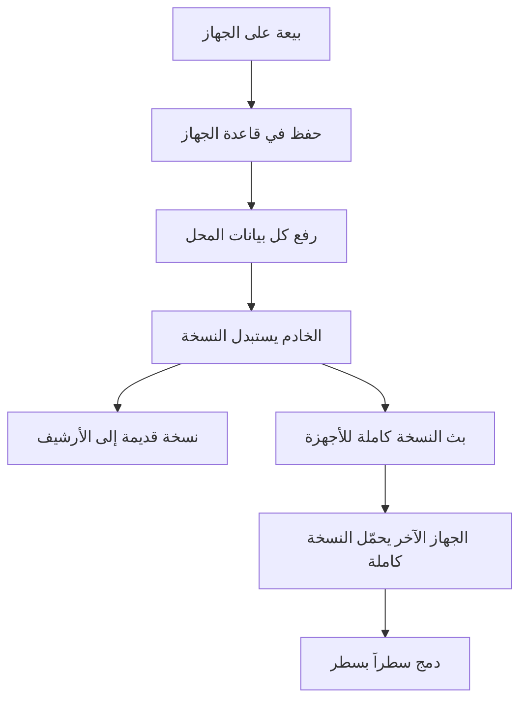
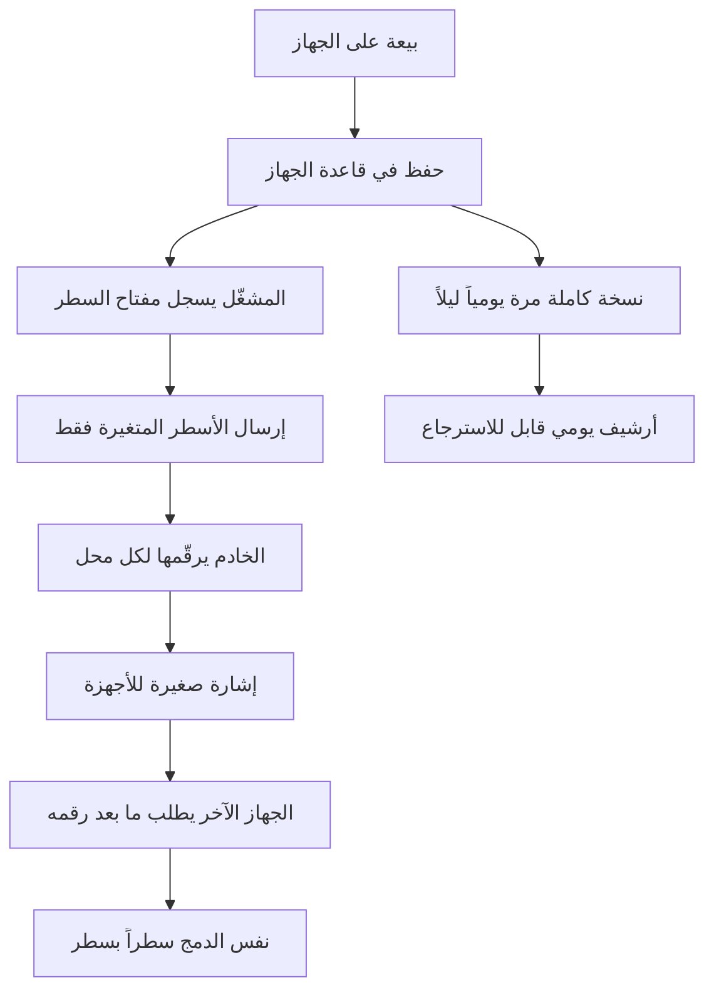

# دراسة: إرسال التعديل فقط بدل النسخة الكاملة

**التاريخ:** 13 نوفمبر 2026، النسخة الرابعة بعد قراءة سجل رفع كل حساب.

**المصادر:**
- القياسات من الخادم `rkofqwcuvbzrnmelvxhz`.
- الكود من فرع `fix/sync-safety-phase1` (`ea306d6`).

الدراسة قراءة فقط، ولم يُغيَّر شيء على الخادم ولا في التطبيق.

**مستويات الدليل:**
- **مثبت:** نتيجة استعلام على الخادم.
- **مقروء:** من الكود، ولم يُشغَّل.
- **تقدير:** حساب مبني على القياسات.

## قرارات المالك

- خطوة سريعة على الخادم أولاً.
- نسخة كاملة يومية تبقى شبكة أمان.
- البداية بالزيوت.
- التجربة على حساب التجربة، ثم محل واحد، ثم الجميع.

**ساعات العمل:** المحلات تعمل من 8 صباحاً حتى منتصف الليل بتوقيت بغداد.

**أي تغيير فيه خطر** يُنفَّذ بين 00:00 و08:00 بتوقيت بغداد، أي بين 21:00 و05:00 UTC.
- **الأفضل:** الساعة 05:00 بتوقيت بغداد (02:00 UTC). فيها أقل رفع: 16 رفعة في 14 يوماً، من حساب واحد.
- **الذروة:** من 17:00 إلى 22:00. أعلاها الساعة 19:00 بـ 242 رفعة في 14 يوماً.

## 1. الخلاصة

1. **الحِمل:**
   - كل تعديل يرفع كل بيانات المحل خلال نصف ثانية، وكل جهاز آخر يحمّلها كاملة.
   - المحل النشط يرفع حوالي 32 مرة في اليوم، وأنشط محل حوالي 96 MB في اليوم.
   - النسخة تكبر بلا حد لأنها تحمل كل التاريخ.
2. **شبكة الأمان مثقوبة اليوم:** المحلات الكبيرة ترفع نسختها مقسّمة إلى أجزاء. التطبيق يحذف أجزاء كل نسخة قديمة بعد الرفع، فأرشيفها لا يمكن استرجاعه.
   - 728 من 740 نسخة مؤرشفة لهذه المحلات بلا أجزاء (مثبت).
   - **هذا يُصلح قبل أي شيء آخر.**
3. **الدمج سطراً بسطر موجود أصلاً، لكنه ليس كاملاً:** 13 جدولاً تُطابق برقم محلي يتولّد تلقائياً، فإذا أضاف جهازان سطراً دون إنترنت يُكتب أحدهما فوق الآخر.
   - هذا خطر اليوم أيضاً، لا يخص الخطة الجديدة.
   - يُعالج قبل نقل هذه الجداول.
4. **التوصية:**
   - سجل تعديلات على الخادم مع نسخة كاملة يومية.
   - يُشغَّل لكل حساب بمفتاح، وفقط عندما تكون كل أجهزته على الإصدار الجديد.
   - البيع لا يتأثر في أي مرحلة، لأنه يُكتب على الجهاز أولاً دائماً.

## 2. تصحيحات على النسخة الأولى وعلى كلامي السابق

| ما قيل | الصحيح | الدليل |
|---|---|---|
| "تبقى نسخة لكل يوم من آخر 30 يوماً" | صحيح للمحلات الصغيرة فقط. للمحلات الكبيرة (النسخ المقسّمة) الأرشيف بلا أجزاء، فلا يُسترجع | 740 نسخة مقسّمة في الأرشيف، 12 منها فقط أجزاؤها موجودة؛ `_deleteStaleSnapshotChunks` في `cloud_sync_service.dart:2762` تحذف كل أجزاء غير آخر رفعة |
| "تنظيف سجل المهام يترك الصفوف بلا وقت انتهاء" | الصفوف بلا وقت انتهاء 6 فقط. الـ 1 GB مساحة ميتة من الحذف المتكرر لم تُرجع للقرص، لا صفوف متراكمة | 58,610 صفاً، 6 بلا `end_time`، أقدمها 30 أكتوبر |
| "المحل يرفع حوالي 4 مرات في اليوم" | حوالي 32 للمحل النشط | قياس 14 يوماً |
| "يمكن معرفة إصدار كل جهاز" | الإصدار 2.2.42 لا يبلّغ عن نسخته. التبليغ أُضيف في الفرع ولم يُصدر بعد | 31 جهازاً بلا نسخة في `account_devices`، و3 بنسخة `2.2.42+266` من بناء الفرع |

## 3. المسار الحالي (مقروء)

| الخطوة | ما يحدث | الدليل |
|---|---|---|
| تعديل محلي | `scheduleSyncSoon` بعد 450 ms: سحب ثم رفع | `cloud_sync_service.dart:1674` |
| ما يُرفع | كل جداول القاعدة إلا 7 مستثناة، فأي جدول جديد يُرفع تلقائياً | `_shouldSyncTable` :5008 |
| متى يُتخطى الرفع | إن لم تتغير بصمة أي جدول (عدد + أحدث وقت) | :2552، `_buildTableSignatures` :5030 |
| الضغط | فقط فوق حوالي 350 KB مضغوطاً، فيُقسم أجزاء. ما دونه JSON بلا ضغط | :203، :2634 |
| الخادم | `rpc_push_snapshot` يستبدل النسخة برقم إصدار متوقع، والمشغّل ينقل القديمة للأرشيف | دالة الخادم (مثبت) |
| أجزاء النسخ الكبيرة | بعد كل رفع يحذف التطبيق أجزاء كل الرفعات الأخرى | :2762 |
| الأجهزة الأخرى | فحص رقم النسخة ثم تحميلها كاملة | :2315-2394 |
| الدمج | حسب الجدول، انظر القسم 5 | `_mergeTableRows` :4107 |

**الطابور الثاني** (`sync_queue_service.dart:333`):
- يرسل تعديلات منفردة لأنواع كثيرة.
- الخادم يحفظ منها المصاريف والصندوق والورديات والألوان والمقاسات فقط.
- الباقي يرد عليه بـ "تم" ولا يحفظه (مثبت من دالة `_rpc_process_sync_queue_legacy_base`).
- حذف المصروف فيها بلا شرط الحساب. الخطر منخفض، والمعرّف عشوائي طويل.

**درس سابق:** رفع الجداول المتغيرة فقط جعل النسخة على الخادم ناقصة، فظهر الصندوق صفراً على جهاز جديد (:2561). القاعدة: **النسخة الكاملة لا تكون ناقصة أبداً.**

## 4. القياسات (مثبتة)

| المؤشر | القيمة |
|---|---|
| حسابات لها نسخة | 27، منها 3 مقسّمة الآن |
| رفعات المحل النشط في اليوم | متوسط 31.8، وسيط 25، أعلى 199 |
| حجم النسخة | متوسط 158 KB، أكبر 3 MB |
| أنشط محل | 33 رفعة × 3 MB ≈ 96 MB في اليوم قبل الضغط |
| ثاني محل | 56 رفعة × 0.9 MB ≈ 49 MB في اليوم بلا ضغط |
| أجهزة لكل حساب | 1.8 |
| أرشيف النسخ | 1060 MB، 3230 نسخة، 30 يوماً |
| أجزاء النسخ الحالية | 66 جزءاً، 15 رفعة، 3 حسابات، 14 MB |
| سجل المهام الدورية | 1020 MB لـ 58,610 صفاً |
| الحارس | وضع تسجيل، حد 20 MB، حد 500 تعديل في الدفعة |

## 4-ب. ما قاله سجل الرفع (30 يوماً، 3230 رفعة، مثبت)

قرأتُ أرشيف الرفع لكل حساب. الأرقام بلا أسماء ولا بيانات زبائن.

### من يرفع؟

| المجموعة | الرفعات | النسبة |
|---|---|---|
| محلان حقيقيان | 2071 | 64% |
| حساب التجربة (4 أجهزة) | 878 | 27% |
| بقية الحسابات (24) | 281 | 9% |

- أغلب الحسابات الـ 24 نسختها حوالي 3.6 KB، أي شبه فارغة، ومن جهاز واحد.
- **المعنى:** الحِمل اليوم يأتي من محلين حقيقيين فقط. المشكلة حقيقية لكنها صغيرة الآن، والخطة تحضير للنمو لا إطفاء حريق. لذلك لا داعي للاستعجال في المراحل 3 إلى 5.

### كيف يرفعون؟

| الملاحظة | الرقم | المعنى للخطة |
|---|---|---|
| رفعتان بينهما أقل من 60 ثانية | حوالي نصف الرفعات | تجميع التعديلات في دفعة واحدة يقلل الطلبات إلى النصف تقريباً |
| رفعتان بينهما أقل من 5 ثوانٍ | 176 في محل واحد | نفس المعنى |
| رفعة مطابقة تماماً للتي قبلها | 0 | حارس الصدى يعمل؛ لا رفع مكرر |
| قفزة في رقم النسخة | 0 | الخادم لم يفقد رفعة بين نسختين |
| إصدار مخطط البيانات | كل الرفعات على الإصدار 3 | لا أجهزة بمخطط قديم في آخر 30 يوماً |
| تبديل الجهاز الرافع | 14 مرة في محل حقيقي، 104 في حساب التجربة | المحلات الحقيقية تعمل غالباً من جهاز واحد؛ تعدد الأجهزة قليل اليوم |
| حساب يتأرجح بين مقسّم وغير مقسّم | 114 من 1139 في محل واحد | حجمه عند حد التقسيم؛ أرشيفه يُسترجع أحياناً ولا يُسترجع أحياناً |

### هل ضاعت بيانات؟

- وجدتُ 130 حالة نقص في عدد الأسطر بين نسختين متتاليتين (فواتير، بطاقات، صندوق) في 3 حسابات.
- فحصتُ الأسطر الناقصة: **كل** الفواتير الناقصة (61) و**كل** البطاقات الناقصة (64) كانت محذوفة من المحل أصلاً (عليها علامة حذف) ثم نُظّفت. وكذلك 144 قيد صندوق في أكبر حالة.
- **الخلاصة:** لم أجد ضياع بيانات في آخر 30 يوماً في النسخ غير المقسّمة.

**حدود هذا الفحص:**
- النسخ المقسّمة (740 نسخة، 4 حسابات) لم تُفحص، لأن الخادم لا يفك ضغطها.
- قيود الصندوق فُحصت في أكبر حالة فقط، لا في كل الحالات.
- الفحص يرى ما وصل الخادم. بيع بقي على جهاز ولم يُرفع لا يظهر هنا.
- البطاقات المفقودة القديمة (77 بطاقة في حسابين، دراسة 12 نوفمبر) أقدم من هذا السجل، ولم أعد فحصها.

**أثر على الخطة:**
- تنظيف الأسطر المحذوفة يجعل عدد الأسطر ينقص طبيعياً. الفحص اليومي لفقدان البيانات يجب أن يعدّ الأسطر غير المحذوفة فقط، وإلا يعطي إنذاراً كاذباً.
- في الطريقة الجديدة، تنظيف سطر محذوف قديم لا يُرسل كتعديل. الحذف نفسه أُرسل من قبل.

## 4-ج. رسوم توضيحية

**الآن:**

**بعد الخطة:**

**الانتقال دون توقف:**

## 5. كيف يُطابق كل جدول عند الدمج (مقروء من `_mergeTableRows`)

| الصنف | الجداول | المطابقة | الخطر |
|---|---|---|---|
| أ. بالمعرّف العام | invoices, invoice_items, service_orders, service_order_items, cash_ledger, customers, suppliers, products, expenses, expense_categories, installment_plans, installments, customer_debt_payments, supplier_bills, supplier_payouts, work_shifts, user_profiles، وسجل المخزون | دالة خاصة لكل جدول | آمن |
| ب. مفتاح طبيعي أو سطر واحد | app_settings (بالمفتاح)، print_settings, debt_settings, installment_settings, loyalty_settings (السطر رقم 1) | الأحدث يفوز على السطر كله | آمن، لكن تعديلان متزامنان على إعداد واحد يفوز أحدهما |
| ج. رقم محلي يتولّد تلقائياً | loyalty_ledger، كتالوجات الزيوت الخمسة، car_wash_services, product_unit_variants, user_permissions, branches, tenants, activity_logs, business_audit_events, oil_change_wa_outbox | بالرقم المحلي، والأحدث يفوز | **سطران جديدان من جهازين دون إنترنت يأخذان نفس الرقم، فيُكتب أحدهما فوق الآخر** |

**الأولوية في الصنف ج:**
1. `loyalty_ledger`، لأنه رصيد نقاط الزبون.
2. كتالوجات الزيوت وخدمات الغسيل.
3. سجلا النشاط والتدقيق: لا يُفقد منهما مال، لكنهما يفقدان أحداثاً.
4. البقية: الفروع والمحل وصلاحيات الموظفين. نادراً ما تُضاف من جهازين.

**الحل لجداول الصنف ج قبل نقلها:**
- يُضاف عمود `global_id` مع فهرس فريد.
- **الأسطر القديمة** تأخذ معرّفاً محسوباً من (الحساب، الجدول، الرقم المحلي)، فكل جهاز يحسب نفس المعرّف دون تنسيق.
- **الأسطر الجديدة** تأخذ معرّفاً عشوائياً.
- **سجلا النشاط والتدقيق:** الرقم المحلي قد يشير لحدثين مختلفين على جهازين، فيُحسب معرّفهما من (الحساب، الجدول، الرقم، وقت الإنشاء). هما للإلحاق فقط، فلا يُعدّلان بعد كتابتهما.
- دالة دمج بالمعرّف العام مثل `_mergeCashLedgerByGlobalId`.

## 6. الثوابت

1. لا تضيع عملية بيع أبداً، ولا قيد صندوق ولا نقطة ولاء.
2. البيع يعمل دون إنترنت في كل مرحلة، ولا تتوقف أي شاشة بيع أثناء أي تغيير.
3. لا يرى حساب بيانات حساب آخر.
4. الجهاز الجديد يستلم بيانات المحل كاملة.
5. الحذف يصل إلى كل الأجهزة.
6. المخزون يساوي مجموع الحركات.
7. أي جهاز على إصدار قديم يبقى يعمل ويرى تعديلات الأجهزة الأخرى.
8. المزامنة فورية كما يشعر بها المستخدم.
9. يوجد دائماً نسخة كاملة قابلة للاسترجاع لكل يوم من آخر 30 يوماً، **لكل** المحلات.

## 7. سيناريوهات الفشل

| السيناريو | اليوم | في التصميم الجديد |
|---|---|---|
| جهازان يبيعان دون إنترنت ثم يتصلان | الصنف أ محمي؛ الصنف ج يفقد سطراً | الطابور المحلي يرسل كل تعديل؛ الصنف ج يُنقل بعد إضافة معرّفه |
| انقطاع أثناء الإرسال | تُعاد النسخة كاملة | مفتاح لكل تعديل، والتكرار لا يُدخل نسخة ثانية |
| إغلاق التطبيق قبل الإرسال | تُرفع النسخة لاحقاً | التعديل يُسجَّل في الطابور داخل معاملة الحفظ نفسها |
| جهاز جديد | يحمّل النسخة كاملة | النسخة اليومية، ثم التعديلات بعد رقمها |
| جهاز غاب أطول من مدة حفظ التعديلات | يحمّل النسخة كاملة | يحمّل النسخة اليومية ثم ما بعدها |
| ساعة الجهاز خاطئة | حماية فرق الساعة موجودة | الترتيب برقم تسلسلي من الخادم |
| جهاز قديم وجهاز جديد على حساب واحد | — | الحساب يبقى على النسخة الكاملة حتى تُحدَّث كل أجهزته |
| محل كبير يحتاج استرجاع نسخة أمس | **مستحيل اليوم**: الأجزاء محذوفة | أجزاء آخر رفعة لكل يوم تُحفظ في أرشيف منفصل |
| تعديل يرتد إلى الجهاز الذي أرسله | حارس صدى موجود | المشغّلات تتوقف أثناء استيراد ما جاء من الخادم، والسحب يتجاهل تعديلات الجهاز نفسه |
| خلل في المرحلة الجديدة بعد التشغيل | — | إطفاء المفتاح من الخادم يرجع الحساب للنسخة الكاملة فوراً، دون تحديث التطبيق |

## 8. الخيارات

**أ. إبقاء النسخة الكاملة مع تخفيفها**
- إصلاح الأرشيف، ونسخة واحدة لكل يوم، وضغط كل رفعة.
- سريع، لكن التحميل الكامل يبقى والحجم يكبر بلا حد.

**ب. سجل تعديلات + نسخة يومية (التوصية)**
- **الالتقاط:** الجهاز يسجّل كل تعديل في `sync_outbox` عبر مشغّلات SQLite.
  - المشغّل يلتقط كل كتابة، حتى لو نسيها كود شاشة.
  - يسجّل مفتاح السطر فقط، والسطر يُقرأ عند الإرسال.
  - يتوقف أثناء الاستيراد بنفس طريقة `StockLedger.setPaused`.
- **الخادم:** جدول `sync_changes` يحفظ لكل تعديل:
  - رقماً تسلسلياً لكل حساب، يُعطى داخل قفل الحساب.
  - رقم جيل الحساب.
  - مفتاحاً يمنع التكرار.
  - الحساب والجهاز.
  - الجدول والمعرّف العام.
  - السطر كاملاً.
- **العزل:** RLS بالحساب، ودالتان `rpc_push_changes` و`rpc_pull_changes`.
- **الاستلام:** الأجهزة تطلب "بعد الرقم N" فقط، بإشارة لحظية صغيرة وسحب احتياطي كل 60 ثانية. التفاصيل في القسم 10.
- **النسخة اليومية:** جهاز واحد يرفعها كاملة مع الرقم الذي وصلت إليه، بالدالة الحالية `rpc_push_snapshot`. فتبقى الأجهزة القديمة والفحوص اليومية تعمل.
- **الدمج:** نفسه الموجود اليوم، `_mergeTableRows`.

**ج. نسخة جداول كاملة على الخادم مرجعاً**
- أفضل للتقارير، لكنه إعادة بناء. ليس الآن.

### الحساب (تقدير)

| | اليوم | بعد الخيار ب |
|---|---|---|
| بيعة واحدة على الشبكة | 158 KB إلى 3 MB | حوالي 5 إلى 10 KB |
| أنشط محل في اليوم | حوالي 96 MB | أقل من 1 MB + نسخة يومية واحدة |
| 500 محل: رفع في اليوم | حوالي 2.5 GB | حوالي 0.2 GB |
| 500 محل: الأرشيف | حوالي 20 GB | حوالي 2 GB |

## 9. التوافق مع الإصدار القديم 2.2.42

- **المسار القديم لا يتغير على الخادم** حتى آخر مرحلة، فالإصدار القديم يرفع ويسحب النسخة كاملة كما اليوم. وهذا يشمل:
  - `rpc_push_snapshot`.
  - `app_snapshots` وأجزاؤها.
  - `rpc_process_sync_queue`.
  - الإشعارات.
- **الإصدار القديم يحذف أجزاء النسخ القديمة.** لذلك إصلاح الأرشيف يكون على الخادم بمشغّل قبل الحذف، لا في التطبيق، فيعمل مع كل الإصدارات.
- **قاعدة التشغيل لكل حساب:** وضع التعديلات يُفعَّل لحساب فقط إذا كانت كل أجهزته النشطة في آخر 30 يوماً تبلّغ عن إصدار يدعمه.
  - الجهاز الذي لا يبلّغ يُعدّ قديماً.
  - إن ظهر جهاز قديم بعد التفعيل، يعود الحساب تلقائياً للنسخة الكاملة.
- **في وضع الانتقال:** الجهاز الجديد يرسل التعديلات **ويرفع النسخة الكاملة** معاً، فيرى الجهاز القديم كل شيء. التوفير يبدأ فقط بعد تحديث كل أجهزة الحساب.
- **شرط مسبق:** إصدار 2.2.43، الذي يبلّغ عن نسخة الجهاز، يجب أن يصل للزبائن قبل أي تفعيل.

## 10. هل الخطة كافية؟ والتحسينات

**الحكم:** الاتجاه صحيح، لكن النسخة السابقة كانت ناقصة في سبع نقاط. بدونها تعمل الخطة في التجربة، وقد تفقد تعديلاً أو تتعطل عند أول استرجاع حقيقي. كلها أُضيفت إلى المراحل في القسم 11.

### ما وجدته في إعادة القراءة

| الملاحظة | الدليل | الأثر |
|---|---|---|
| الخادم يبث بيانات المحل كاملة إلى كل جهاز عند كل رفع، ثم يحمّلها الجهاز مرة ثانية | عمود `payload` ضمن أعمدة النشر اللحظي لجدول `app_snapshots` (مثبت)؛ التطبيق لا يقرأ ما يصله، بل يستعمله إشارة فقط ثم يسحب (`cloud_sync_service.dart:1797-1812`) | نقل مضاعف بلا فائدة. حد حجم الرسالة اللحظية لم أقِسه |
| لا توجد دالة استرجاع على الخادم | لا دالة باسم restore في `public` أو `ops_private` (مثبت) | الاسترجاع اليوم يدوي ولم يُجرَّب قط |
| الجهاز لا يسحب دورياً؛ يعتمد على الإشارة اللحظية وعلى عودة الشبكة | المؤقت كل دقيقة يرفع فقط (`:1722-1728`) | إن فاتت إشارة يبقى الجهاز متأخراً حتى التعديل التالي |
| طريقة إيقاف المشغّلات أثناء الاستيراد موجودة ومجرَّبة | `stock_ledger.dart:57-87` | نستعملها نفسها، لا اختراع جديد |
| مسار إشعار صغير موجود (`sync_notifications`) ويعرف الجهاز المرسل | `:1895-1915`، 73 إشعاراً في آخر 24 ساعة | يصلح إشارة للتعديلات الجديدة |

### التحسينات السبعة

**1. ترتيب لا يفوّت تعديلاً.**
- الرقم التسلسلي يكون **لكل حساب**، ويُعطى داخل قفل صف الحساب، كما تفعل `rpc_push_snapshot` اليوم.
- السبب: الرقم العام يسمح بأن يظهر الرقم 10 قبل أن يُحفظ الرقم 9، فيتجاوزه جهاز إلى الأبد.

**2. طابور صغير لا يكبر.**
- المشغّل يسجّل **مفتاح السطر فقط** (الجدول + المعرّف + نوع العملية)، لا نسخة من السطر.
- عند الإرسال يُقرأ السطر الحالي. عشرة تعديلات على بطاقة واحدة تصير إرسالاً واحداً.
- الإرسال دفعات حتى 200 سطر، بعد 300 ms من آخر تعديل، مع إعادة محاولة متباعدة.

**3. مؤشر الاستلام داخل القاعدة.**
- آخر رقم استلمه الجهاز يُحفظ في SQLite **داخل معاملة الدمج نفسها**.
- فلا يُطبَّق تعديل مرتين، ولا يُتجاوز تعديل إذا أُغلق التطبيق في المنتصف.

**4. إشارة صغيرة بدل بث البيانات.**
- بعد كل دفعة يكتب الخادم إشعاراً صغيراً فيه رقم آخر تعديل فقط.
- الأجهزة تسحب ما بعد رقمها. الهدف: التعديل يظهر على الجهاز الآخر خلال ثانية إلى ثانيتين (يُقاس في المرحلة 4).
- **شبكة أمان:** سحب خفيف كل 60 ثانية وعند فتح التطبيق وعودة الشبكة. يسأل "هل يوجد بعد رقمي؟" ويرجع فارغاً غالباً.
- **مكسب سريع يحتاج تجربة:** إخراج عمود `payload` من النشر اللحظي لجدول `app_snapshots`. الأجهزة القديمة لا تقرؤه، فلا تتأثر. يُجرَّب على فرع خادم أولاً، لأني لم أتحقق أن خدمة البث تدعم قائمة الأعمدة.

**5. استرجاع سريع ومجرَّب.**
- دالة خادم للإدارة فقط: تعيد محلاً إلى نسخة يوم محدد، وتعمل للمحلات الكبيرة من أرشيف الأجزاء.
- **رقم جيل لكل حساب:** الاسترجاع يرفع رقم الجيل. كل جهاز يرى جيلاً أحدث يترك مؤشره ويأخذ النسخة الكاملة من جديد. وكل تعديل يحمل رقم جيل قديم يُرفض.
- **تجربة استرجاع** على حساب التجربة قبل المرحلة 5، ثم مرة كل شهر. نسخة احتياطية لم تُجرَّب لا تُحسب.

**6. كشف الانحراف تلقائياً.**
- مع النسخة اليومية يُرفع عدد الأسطر وبصمة كل جدول.
- إن اختلف جهاز عن النسخة بعد تطبيق كل التعديلات، يُسجَّل الفرق ويأخذ الجهاز النسخة الكاملة. الدمج لا يحذف ما لم يُرفع بعد.
- الفحص اليومي الحالي لفقدان البيانات يبقى، ويُضاف له عمر آخر تعديل وطول الطابور لكل جهاز.

**7. أمان وبساطة.**
- **الوصول:** لا كتابة ولا قراءة مباشرة على جدول التعديلات، بل عبر دالتين فقط. الحساب يؤخذ من جلسة الدخول، لا من الطلب.
- **الحدود:**
  - قائمة الجداول المسموحة الموجودة (`sync_guard_allowed_tables`).
  - حد حجم السطر وعدد الأسطر في الدفعة.
  - الجهاز الموقوف لا يرسل ولا يستلم.
- **مسار واحد:** الطابور القديم (`sync_queue`) يُطفأ للأنواع التي تنتقل إلى الطريقة الجديدة، فلا يبقى مساران لنفس البيانات.
- **مدة الحفظ:** التعديلات 35 يوماً. الجهاز الذي غاب أطول يأخذ النسخة اليومية.

### الكلفة

| البند | الأثر |
|---|---|
| الخادم الحالي | يكفي. الطلبات تصير أصغر بمئات المرات، فالحِمل على الذاكرة والمعالج ينزل |
| التخزين | يبقى تحت 8 GB المشمولة حتى 500 محل (تقدير: حوالي 2 GB) |
| البث اللحظي | الخطة تشمل عدداً من الاتصالات المتزامنة والرسائل. من معرفتي: 500 اتصال، وما زاد بنحو 10 دولارات لكل 1000. يُراجع في لوحة Supabase عند تجاوز 250 محلاً |
| أرشيف أطول من 30 يوماً | إن أردته لاحقاً يُنقل إلى مخزن الملفات (100 GB مشمولة) بدل القاعدة. ليس الآن |

## 11. مراحل التنفيذ والجدول الليلي

- كل مرحلة تُنشر وتُرجع وحدها.
- التغييرات على الخادم تُنفَّذ الساعة 05:00 بتوقيت بغداد (02:00 UTC)، بعد المهام الليلية الحالية وقبل فتح المحلات.
- إصدارات التطبيق تنزل للزبائن متى شاءت المتاجر، فكل جديد فيها **مطفأ** حتى يُشغَّل المفتاح من الخادم ليلاً.

**كيف يستمر البيع في كل مرحلة:**
- البيع يُكتب في SQLite على الجهاز أولاً.
- فشل أي رفع أو سحب لا يوقف البيع؛ يظهر تنبيه مزامنة فقط، وتُعاد المحاولة.
- لا توجد مرحلة تغلق الرفع القديم قبل أن يعمل الجديد على نفس الحساب.

| المرحلة | ماذا | متى | التحقق | الرجوع |
|---|---|---|---|---|
| **0-أ** إنقاذ أرشيف المحلات الكبيرة | جدول `app_snapshot_chunks_archive` ومشغّل قبل حذف الأجزاء ينسخها إليه. لا يمس الرفع ولا السحب | ليلة 1، 05:00 | بعد أول رفعة مقسّمة صباحاً: أجزاء الرفعة السابقة في الأرشيف، وحجمها يطابق | حذف المشغّل؛ لا يتغير أي سلوك |
| **0-ب** أرشيف بنسخة يومية | مهمة ليلية: كل نسخ آخر 24 ساعة + آخر نسخة لكل يوم، ونفس القاعدة لأرشيف الأجزاء. يحذف حوالي 3047 من 3230 نسخة | ليلة 2، 05:00، **بموافقة المالك لأن المحذوف لا يعود** | لكل حساب: نسخة لكل يوم، والنسخة الحالية لم تُمس، وفحص فقدان البيانات اليومي سليم | إطفاء المهمة؛ المحذوف لا يعود، وتبقى نسخة لكل يوم |
| **0-ج** استرجاع المساحة | إفراغ سجل المهام الدورية (سجل تشغيل فقط، لا بيانات محلات)، ثم `VACUUM FULL` لأرشيف النسخ بعد تخفيفه | ليلة 3، 05:00 | حجم القاعدة ينزل حوالي 1.9 GB؛ المهام تكمل؛ أول رفعة بعدها تنجح | لا شيء يُرجع؛ القفل ثوانٍ، والرفعة المنتظرة تكمل بعده |
| **0-د** استرجاع مجرَّب | دالة استرجاع للإدارة فقط + تجربتها على حساب التجربة، ومنها نسخة مقسّمة | ليلة 4، 05:00 | حساب التجربة يعود لنسخة أمس، وأجهزته تستلمها كاملة | حذف الدالة؛ لا تُستدعى إلا يدوياً |
| **0-هـ** تخفيف البث (بعد تجربة) | إخراج `payload` من النشر اللحظي لجدول `app_snapshots`. يُجرَّب على فرع خادم أولاً | ليلاً بعد نجاح التجربة | جهاز قديم وجهاز جديد يستلمان تعديل الآخر خلال ثوانٍ | إعادة العمود للنشر بأمر واحد |
| **1** الإصدار 2.2.43 | تبليغ نسخة الجهاز (موجود في الفرع) + إيقاف إرسال الأنواع التي يتجاهلها الطابور + شرط الحساب في حذف المصروف (خادم) | بعد اختبار ويندوز | نسبة الأجهزة المبلّغة في `account_devices` | مفتاح الإطفاء الموجود |
| **2** معرّف عام للصنف ج | الولاء أولاً، ثم كتالوجات الزيوت والغسيل، ثم السجلات | إصدار تالٍ؛ المطابقة الجديدة مطفأة حتى يُشغَّل المفتاح ليلاً | اختبار جهازين يضيفان دون إنترنت؛ عدد أسطر كل جدول قبل وبعد | إطفاء المفتاح يعيد المطابقة القديمة |
| **3** التقاط التعديلات (ظل) | `sync_outbox` بمفاتيح الأسطر ومشغّلاته، يسجل ولا يرسل. مؤشر الاستلام داخل SQLite | نفس الإصدار، مطفأ | اختبار: النسخة القديمة + التعديلات على جهاز فارغ = النسخة الحالية سطراً بسطر؛ قياس الكلفة على هاتف ضعيف | إطفاء المفتاح |
| **4** خادم التعديلات + إرسال مزدوج | `sync_changes` برقم لكل حساب ورقم جيل، والدالتان، والإشارة الصغيرة، والسحب الاحتياطي. الجهاز يرسل التعديلات **ويرفع النسخة كالعادة** | ليلاً، حساب التجربة فقط | مقارنة يومية بين التعديلات والنسخة؛ قياس زمن الوصول بين جهازين (الهدف أقل من ثانيتين)؛ اختبار عزل: حساب لا يقرأ تعديلات حساب آخر | إطفاء المفتاح؛ النسخة الكاملة لم تتوقف أصلاً |
| **5** تبديل الزيوت | الاستلام بالتعديلات، والنسخة الكاملة مرة يومياً ليلاً مع بصمة كل جدول. الطابور القديم يُطفأ للأنواع المنقولة | ليلاً: حساب التجربة ثم أسبوع ثم محل زيوت واحد ثم أسبوع ثم كل محلات الزيوت التي كل أجهزتها محدثة | عدادات `ops_account_daily_metrics` لا تنقص، فحص فقدان البيانات أخضر، لا انحراف في البصمات، حجم الرفع ينزل | إطفاء المفتاح للحساب يعيد النسخة الكاملة فوراً |
| **6** بقية التخصصات ورفع الحد الأدنى للإصدار | نفس الطريقة | بعد شهر نظيف | نفس التحقق | نفس الرجوع |

### حالة التنفيذ (14 نوفمبر 2026، 03:00 بغداد)

| المرحلة | الحالة | الملف |
|---|---|---|
| 0-أ أرشيف الأجزاء | طُبّقت 02:23. التحقق الكامل بعد أول رفعتين مقسّمتين | `migrations/20261114_snapshot_chunks_archive.sql` |
| 0-ب نسخة يومية | طُبّقت 02:34 دون حذف. أول تخفيف بالمهمة الليلية 05:00 (المعاينة: 2989 من 3270) | `migrations/20261114_snapshot_history_daily.sql` |
| 0-ج استرجاع المساحة | سجل المهام فُرّغ 02:28 (القاعدة من 2241 إلى 1222 MB). ضغط الأرشيف مجدول 05:20 بمهمة على جهاز المالك | `migrations/20261114_snapshot_history_vacuum.sql` |
| 0-د استرجاع مجرَّب | الدالة طُبّقت 02:44. **التجربة مؤجلة بقرار المالك**: كل نسخ حساب التجربة مقسّمة وأجزاؤها حُذفت قبل 0-أ، فتحتاج رفعتين جديدتين منه | `migrations/20261114_snapshot_restore.sql` |
| 1 (جزء الخادم) | حارس الحساب على `cash_ledger` و`work_shifts` طُبّق. دالة الطابور مملوكة لـ postgres فكانت تتجاوز RLS وتحذف وتحدّث بـ global_id فقط. جدول `expenses` غير موجود على الخادم، فحذف المصروف لا يعمل أصلاً | `migrations/20261114_sync_queue_tenant_guard.sql` |
| 0-هـ تخفيف البث | لم تبدأ؛ تحتاج فرع خادم للتجربة | - |

**تصحيح على المرحلة 1: «إيقاف إرسال الأنواع التي يتجاهلها الطابور» يُلغى من الإصدار 2.2.43.**
- الطابور ليس فقط للحفظ. بعد كل حركة، حتى المهملة، يُدرج الخادم صفاً في `sync_notifications`، والأجهزة الأخرى تسحب النسخة فوراً عند استلامه (`cloud_sync_service.dart` :1913-1915). فهو إشارة لحظية.
- الإشارة تكرار لبث `app_snapshots` الذي يصل بعد كل رفع، فإيقافها فائدته صغيرة، وخطره بطء الاستلام إن تأخر الرفع. القرار يُترك للمرحلة 4 حين تحل الإشارة الصغيرة محلهما.
- في 7 أيام: 65 إشارة فقط (طلبات خدمة وزبائن وورديات وصندوق).

**ملاحظات جديدة من نفس القراءة (مقروءة، لم تظهر كأعطال):**
- إشارة حذف تحذف السطر من الجهاز الآخر حذفاً نهائياً بـ global_id (`_processDeltas` :2016-2024)، لا حذفاً منطقياً ولا شاهد حذف. يُراجع في المرحلة 3.
- جدولا `expenses` و`expense_categories` غير موجودين على الخادم. حركات المصروف تفشل في الطابور، وجلب الإشارة لها يفشل فيُعاد في كل حدث لاحق (:2003-2010).

**المرحلة 2 (بدأت 14 نوفمبر): كتالوجات الزيوت والغسيل.**
- قياس الاستخدام (24 محلاً بنسخة غير مقسّمة): كتالوج الزيت 4 محلات، الفلاتر 2، الهيدروليك 2، أنواع الفلاتر 3، خدمات الزيت 1، الغسيل 0. سجل التدقيق 23 محلاً (1760 سطراً). الولاء محل واحد بسطر واحد.
- قرار المالك: المعرّف العام (لا المفتاح الطبيعي)، وكل الأجهزة ستُحدَّث.
- التنفيذ (`lib/services/catalog_identity.dart` و`_mergeCatalogByGlobalId`):
  - عمود `global_id` وفهرس فريد في الجداول الستة. السطر الجديد معرّف عشوائي. السطر القديم معرّف محسوب من (الجدول، وقت الإنشاء، المفتاح الطبيعي)، والأنواع المدمجة من الكود وحده.
  - الدمج: بالمعرّف؛ وإن لم يوجد، بالمفتاح الطبيعي فيأخذ الجهازان المعرّف الأصغر؛ وإلا إدراج برقمه إن كان فارغاً، وإلا برقم جديد.
  - الحذف منطقي ويصل كأي تعديل.
  - المفتاح `SyncSafety.catalogIdentity` مطفأ. العمود والمعرّفات تُضاف دائماً، ولا تغيّر السلوك القديم.
- **روابط الطلبات بالكتالوج (تصحيح):** `serviceId` يشير لجدول المنتجات لا للكتالوج (`getProductById`)، والمنتجات لها معرّف عام من قبل. `catalogEntryId` داخل `oilFiltersJson` يُستعمل فقط عند فتح بطاقة للتعديل: كان رقم من جهاز آخر قد يشير لفلتر آخر فيضع اسمه وسعره في البطاقة. الآن الاسم المحفوظ في البطاقة هو الحكم، وإن اختلف يُبحث بالاسم. الأسماء والأسعار محفوظة نصاً في الطلب، فالفاتورة لا تتأثر.
- **سجلا النشاط والتدقيق (`LogIdentity` و`_mergeLogByGlobalId`):** إضافة فقط. المعرّف نص من (الرقم الأصلي، وقت الإنشاء، النوع)، يكتبه مشغّل في القاعدة لكل سطر جديد، فلم يتغير كود الإضافة. السطر المعروف لا يُعدَّل، والجديد يُدرج برقم جديد إن كان رقمه مأخوذاً. التدقيق الأقدم من 90 يوماً لا يعود بعد تنظيفه. تحت المفتاح نفسه.
- **حد الانتقال:** خدمات الزيت والغسيل بلا مفتاح طبيعي. سطر أضافه جهاز محدَّث يصل لجهاز قديم بلا معرّفه، فإن تحدّث الجهاز القديم لاحقاً وحسب له معرّفاً آخر صار السطر مكرراً. لذلك يُشغَّل المفتاح بعد تحديث كل أجهزة المحل.
- **فئات الفلاتر المخصصة:** كودها يتولد محلياً بالتسلسل، فجهازان يضيفان فئتين مختلفتين بنفس الكود تُدمجان في واحدة (كما اليوم). يحتاج كوداً عشوائياً لاحقاً.
- **الولاء مؤجل لدراسة مستقلة:** رصيد النقاط محمي محلياً في دمج الزبائن فلا ينتقل بين الأجهزة، وسطر سجل النقاط يحمل رقم الزبون المحلي فيُربط بزبون آخر على الجهاز الثاني. الإصلاح: رصيد محسوب من الحركات كالمخزون.
- **خلل قديم ظهر في الاختبارات:** `_ensureProductVariantsGlobalIds` يكتب `TRIM(global_id) = ""` بعلامتي اقتباس مزدوجتين، فيفشل على SQLite الحديث ويُتجاهل. لم أتحقق من سلوكه على الهواتف.

**المرحلة 3 (14 نوفمبر): التقاط التعديلات، وضع الظل.**
- **التنفيذ (`lib/services/change_capture.dart`):**
  - جدول `sync_outbox`: سطر واحد لكل (جدول، مفتاح)، والتعديل التالي يستبدله برقم ترتيب جديد. المفتاح `global_id`، وإلا `id`.
  - ثلاثة مشغّلات لكل جدول يُرفع: إضافة، وتعديل، وحذف. تعديل يغيّر المفتاح يسجل حذف القديم.
  - اسم المشغّل يحمل عمود المفتاح، فجدول يأخذ `global_id` لاحقاً يُعاد مشغّله.
  - جدول `sync_cursor` لمؤشر الاستلام ورقم الجيل، ويُكتب في المرحلة 4 داخل معاملة الدمج.
  - في وضع الظل لا يُرسل شيء، وللسجل حد 20000 سطر.
- **الإيقاف:** الالتقاط متوقف أثناء استيراد النسخة، وأثناء `_processDeltas`، وأثناء `applyCapturedChanges`، وأثناء إفراغ بيانات المحل عند تبديل المستخدم. بدون الأخير كان الإفراغ سيسجل حذف كل سطر في المحل.
- **قائمة الجداول:** `lib/services/sync_tables.dart` قائمة واحدة للنسخة وللالتقاط. `local_migration_issues` يبقى في النسخة لتشخيص الهاتف، ولا يُلتقط.
- **تصحيح صغير:** فتح القاعدة كان يكتب `isActive = 1` للمستأجر الافتراضي كل مرة. صار يكتب فقط إن تغيّر، فلا يُلتقط تعديل وهمي.
- **المفتاح:** `SyncSafety.changeCapture` مطفأ، ويُقرأ عند فتح القاعدة. الإطفاء يحذف المشغّلات.
- **الاختبار المطلوب (مثبت بتشغيل):** نسخة قديمة + التعديلات الملتقطة بعد مرورها بـ JSON على جهاز آخر = الجهاز الأصلي، سطراً بسطر في كل جدول يُلتقط. الجهاز المستلم لم يلتقط شيئاً. 6 اختبارات في `change_capture_test.dart`.
- **الكلفة (على Mac، لا هاتف ضعيف):** 192 مشغّلاً. 6000 كتابة بين 1.7 و2.0 ثانية دون الالتقاط، وحوالي 1.9 ثانية معه، فالفرق ضمن تفاوت القياس. فتح القاعدة يزيد حوالي 28 ms. لم يُقس على هاتف ضعيف بعد.
- **قبل المرحلة 4:**
  - مراجعة كل حذف جماعي في التطبيق غير الإفراغ (مثل التنظيف بعد 90 يوماً): يُسجَّل حذفاً ويُرسل.
  - `reconcileUserDirectoryAfterCloudImport` يكتب بعد الاستيراد خارج المعاملة، فقد يُلتقط.
  - الحذف الوارد في `applyCapturedChanges` حذف نهائي بالمفتاح، كإشعار الحذف اليوم.

**المرحلة 4، جزء الخادم: طُبِّق 14 نوفمبر الساعة 06:35 بغداد بموافقة المالك.** قبل التطبيق: لا معاملات طويلة، ولا أقفال على `app_snapshots`. بعده: الجداول الثلاثة والصلاحيات والبث والمشغّل والمهمة كما في الملف، ولا حساب مشغّلاً. ملاحظات المستشار الجديدة متوقعة: جدولان بلا سياسة عن قصد، ودالتان متاحتان للمسجّلين تتحققان من الحساب بنفسيهما. الملف `migrations/20261115_sync_changes.sql` (أول SHA-256: 4945f8fb) وملف رجوعه.
- **الجداول:**
  - `sync_account_state`: آخر رقم، ورقم الجيل، والتشغيل لكل حساب.
  - `sync_changes`: الرقم فريد لكل حساب، ومفتاح عدم التكرار فريد لكل حساب.
  - `sync_change_signals`: سطر واحد لكل حساب فيه آخر رقم فقط، يُبث لحظياً، والجهاز يقرأ سطره وحده.
  - لا قراءة ولا كتابة مباشرة على الجدولين الأولين.
- **`rpc_push_changes`:**
  - تقفل صف الحساب وتعطي الأرقام بالتتابع.
  - تتحقق من الدفعة كلها قبل الكتابة: حتى 200 تعديل، والسطر حتى 256 KB، والجدول من `sync_guard_allowed_tables`.
  - ترفض الجهاز الموقوف والجيل القديم.
  - إعادة الإرسال تعيد الرقم نفسه.
- **`rpc_pull_changes`:** تعيد ما بعد رقم الجهاز حتى 1000 سطر. تطلب النسخة الكاملة إن تغيّر الجيل، أو إن حُذف من السجل ما بعد رقم الجهاز.
- **الجيل:** مشغّل على `app_snapshots` يرفعه حين يكتب الاسترجاع `restore:<id>`، دون تعديل دالة الاسترجاع.
- **التشغيل:** كل حساب مطفأ حتى `ops_private.set_sync_changes_enabled`، فالتطبيق على الخادم لا يغيّر شيئاً لأي محل.
- **التنظيف:** التعديلات الأقدم من 35 يوماً تُحذف الساعة 06:50 بغداد.
- **اختبار محلي (Postgres 18، مثبت بتشغيل):** 58 من 58، منها:
  - جهازان يرسلان 80 دفعة معاً بلا فجوة ولا تكرار في الأرقام.
  - حساب لا يرى تعديلات حساب آخر.
  - إعادة التطبيق والرجوع.
- **لم يُختبر:** البث اللحظي الفعلي للإشارة، وصلاحيات Supabase الحقيقية. يحتاج حساب التجربة بعد التطبيق.
- **التطبيق:** ليلاً بين 00:00 و08:00، بموافقة المالك. ثم جزء التطبيق في المرحلة 4: الإرسال المزدوج والاستلام.

**حد مهم للاسترجاع (مقروء من `_importSnapshot`):** الجهاز يدمج النسخة المسترجعة ولا يحذف شيئاً، والأحدث يفوز. الاسترجاع يُعيد الأسطر الناقصة، ولا يرجع بالمحل كله إلى الماضي.

### اختبارات قبل المرحلة 5

- جهازان دون إنترنت يبيعان ويضيفان نقاط ولاء ثم يتصلان.
- حذف بطاقة على جهاز ووصوله للآخر.
- جهاز جديد يستلم كل شيء.
- جهاز قديم وجهاز جديد على حساب واحد.
- إرسال مكرر، وإغلاق التطبيق أثناء الإرسال.
- ساعة جهاز خاطئة.
- جهاز غاب أطول من مدة حفظ التعديلات.
- استرجاع نسخة أمس لمحل كبير من الأرشيف، وكل أجهزته تنتقل للجيل الجديد.
- دفعتان من جهازين في اللحظة نفسها: لا يُفقد رقم ولا يتكرر.
- إشارة لحظية مفقودة: السحب الاحتياطي يلتقط التعديل خلال دقيقة.
- جهاز موقوف يحاول الإرسال فيُرفض.

## 12. ما لم أتحقق منه

- محتوى النسخ المقسّمة في فحص ضياع البيانات (740 نسخة).
- قيود الصندوق الناقصة في غير أكبر حالة.
- لماذا يتراكم عدد كبير من قيود الصندوق المحذوفة في محل واحد (حوالي 100 كل بضعة أيام).

- مفتاح جدول `oil_change_wa_outbox`: لم أجد تعريف إنشائه.
- كمية النقل الفعلية (egress): تظهر في لوحة Supabase فقط.
- سلوك الويب وويندوز في المسار الجديد.
- كلفة مشغّلات SQLite على هاتف ضعيف.
- محتوى النسخ المقسّمة: الخادم لا يفك ضغطها، فجدول الجداول في القسم 5 مأخوذ من النسخ غير المقسّمة، لكن الكود واحد للجميع.
- هل تدعم خدمة البث اللحظي قائمة أعمدة في النشر (المرحلة 0-هـ)، وحد حجم رسالتها.
- حصص البث اللحظي في خطتك: الأرقام من معرفتي لا من لوحتك.
- هل يوجد مسار آخر يحذف أجزاء النسخ غير `_deleteStaleSnapshotChunks`، مثل الإصدارات الأقدم من 2.2.42.
