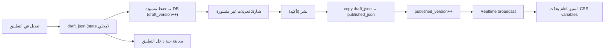

# فصل تخصص المطاعم — Spec v1.0 (Naboo Restaurant)

> **الحالة:** معتمد — مراحل 0–4 مبنية + تعديل واجهة رئيسية POS (قيد التنفيذ/التثبيت)
> **التاريخ:** 2026-08-22
> **المراجع:** `vertical_pharmacy_migration_v1.md` · `vertical_oil_change_migration_v1.md` · `feature_gate_v1.md` · `.cursor/skills/naboo-erp-market/SKILL.md`
> **النطاق:** تحويل `restaurant_cafe` من placeholder إلى **Vertical Module** كامل تحت `lib/verticals/restaurant/` — monorepo واحد، بدون packages منفصلة
> **Framework:** Flutter + `provider` + `sqflite` + `supabase_flutter` + `VerticalManifest` — نفس مكدس Naboo (**لا إطار جديد**)
> **Plan file:** `.cursor/plans/restaurant_vertical_plan_ee9332ac.plan.md`

---

## 0. ملخص القرارات المعتمدة (Executive Summary)

| # | القرار | الاختيار المعتمد |
|---|--------|-------------------|
| 1 | القنوات في MVP | داين-إن QR + رابط عام (استلام) + كاشير — طابور مطبخ موحّد |
| 2 | الدفع | عند الكاشير / عند الاستلام؛ لا بوابة دفع إلكتروني |
| 3 | نموذج الجلسة | **جلسة = فاتورة واحدة**؛ تُقفل عند الدفع؛ أي طلب لاحق = جلسة جديدة (`session_seq++`) |
| 4 | خصم المخزون | عبر **الوصفة (BOM)** لا كوحدات رف؛ حجز عند accepted؛ استهلاك عند preparing |
| 5 | فشل المكوّن الحرج | **رفض صارم** وقت الطلب ووقت auto-accept؛ إلغاء بند وقت الطبخ + إشعار |
| 6 | تكلفة الطعام | **snapshot دائم** لكل بند — التقارير التاريخية لا تعيد الحساب |
| 7 | العمل بلا إنترنت | كاشير + KDS يعملان **LAN-only** (Naboo Hub + mDNS)؛ QR العام يتطلب سحابة بصراحة |
| 8 | أمان QR | QR ثابت بـ `tenant_slug` + `table_slug` فقط؛ الجلسة سيرفر-سايد؛ `session_seq` داخلي |
| 9 | Rate limiting | مُفعَّل من اليوم الأول على Edge Function (لكل قناة) |
| 10 | auto-accept | **سيرفر-سايد** (Edge Function مجدولة)؛ يعيد فحص المكوّن الحرج قبل الترقية |
| 11 | ذرية الحجز | فحص + كتابة `reservations` في **transaction واحد** (لا خطوتين من التطبيق) |
| 12 | invoice_id | `Order.invoice_id == Session.invoice_id` مفروض بـ CHECK/trigger DB-level |
| 13 | وحدات الكميات | `qty_micro:int` + `base_unit` (`g`/`ml`/`piece`) صريح — **لا `double` أبداً** |
| 14 | Market | `restaurant_cafe` مسموح لنقل الماركت لاحقاً؛ MVP لا يعتمد عليه |
| 15 | صنف بلا وصفة | **مرفوض في منشئ المنيو** إلا إذا حُدِّد `direct_stock_sku_id` |
| 16 | Menu Theme | **preset = architecture** كامل (typography + spacing + geometry + cards + nav + …) لا colors فقط. 6 presets، 6 خطوط عربية، 4 ألوان قابلة للتخصيص، Logo + Cover. الاتجاه **مشتق من `menu_language`** لا خيار حر. Draft → Preview → Publish صريحان؛ Realtime للـpublished فقط |
| 17 | صور البند | **حتى 5 صور** لكل بند، صورة أساسية واحدة إلزامياً؛ pipeline معالجة سيرفري يولّد variants (thumb/medium/large × WebP/JPEG)؛ listing = primary lazy، detail = أولى eager والباقي lazy؛ `alt_ar` + `alt_en` (وصف موضوعي لا تسويقي) |
| 18 | Fonts hosting | **self-hosted** (Supabase Storage / static assets) لا Google Fonts CDN — لتفادي تبعية طرف ثالث في LCP path. المختار **فقط** يُحمَّل، وزن 400 preload أولاً |
| 19 | رئيسية التشغيل (Staff Home) | **ليست** لوحة ملخصات تجزئة. واجهة POS: شريط أقسام منيو + شبكة مربعات (صورة + اسم). الضغط على صنف → سلة طاولة/جلسة. إخفاء بيع رف / مخزون رف / ديون من الرئيسية والملاحة |
| 20 | مضيف المنيو العام | **`https://naboo.fun`** (HTTPS) — روابط QR والرابط العام والـ tracking؛ تصميم ضيوف من نظام Stitch «Royal Naboo Reserve» |

---

## 1. الملخص التنفيذي المعماري

### 1.1 الهدف

تحويل `restaurant_cafe` (اليوم placeholder فقط في [`lib/services/business_setup_settings.dart`](../../lib/services/business_setup_settings.dart)) إلى **Vertical Module** كامل تحت `lib/verticals/restaurant/`، بنفس نمط `oil_change` و `pharmacy`:

- **Core** يوفّر: auth · tenant · customers · cash · invoices · products shell · navigation shell.
- **Restaurant vertical** يوفّر: menu · modifiers · recipes (BOM) · tables · sessions · orders · KDS · Hub sync · public menu bridge · owner KPIs.
- **صفر** `if (restaurant)` في ملفات Core بعد اكتمال المرحلة 3.

### 1.2 الفصل الثلاثي (مرجع)

```
┌────────────────────────────────────────────────────────────┐
│ Menu Layer (منتج للعميل)                                    │
│ categories · items · prices · modifiers · availability     │
└──────────────────────────┬─────────────────────────────────┘
                           │  recipe
┌──────────────────────────▼─────────────────────────────────┐
│ Recipe / BOM Layer                                          │
│ menu_item → product_id + qty_micro + base_unit + critical  │
└──────────────────────────┬─────────────────────────────────┘
                           │  consumes
┌──────────────────────────▼─────────────────────────────────┐
│ Stock Layer (منتجات Naboo القائمة)                          │
│ products · stock movements · cost · warehouses              │
└─────────────────────────────────────────────────────────────┘
```

**Session Layer** يعبر عمودياً: جلسة الطاولة تجمع طلبات متعددة تحت فاتورة واحدة.

### 1.3 الفرق الجوهري عن باقي الأقسام

| تجزئة / سوبرماركت | مطعم Naboo |
|-------------------|------------|
| بيع وحدة منتج من الرف | بيع **طبق منيو** غير مخزَّن كقطعة |
| خصم المخزون = كمية المنتج المباع | خصم المخزون = **مقادير الوصفة** |
| فاتورة لحظية عند البيع | فاتورة **مسودة تُبنى تدريجياً** طوال الجلسة |
| Market logistics statuses | حالات مطبخ لكل طلب |

### 1.4 الوضع الحالي في الكود

| موجود | ناقص |
|-------|------|
| `BusinessVertical.restaurantCafe` في onboarding | `lib/verticals/restaurant/` |
| افتراضيات: POS · ولاء · services=true | `RestaurantVerticalManifest` |
| نمط `VerticalManifest` جاهز | جداول (`restaurant_*`) |
| Edge Functions للماركت كنمط أمان | Edge Function `restaurant-create-order` |
| Realtime في Supabase | KDS + LAN Hub |
| نمط `oil_change_stock_service` للحجز | Recipes/BOM + reservations |

---

## 2. النطاق (Scope)

### 2.1 داخل MVP (المراحل 0-4)

- Vertical manifest كامل + feature gates.
- منشئ منيو (فئات، أصناف، صور، modifiers).
- منشئ وصفات (recipe lines بـ `qty_micro` + `base_unit`).
- خريطة طاولات بسيطة (شبكة أرقام، لا محرر أرضية).
- كاشير مطعم (بديل `add_invoice` للمطاعم).
- KDS Flutter (ملء الشاشة، صوت، ألوان عمر البطاقة).
- LAN Hub sync (mDNS + WebSocket).
- Sessions FSM كامل + Table FSM مشتقة.
- Reservations ذرية + snapshot تكلفة.
- Public menu web (admin-web PWA) + Edge Function `restaurant-create-order` مع rate limits.
- Auto-accept سيرفر-سايد + إعادة فحص.
- QR generator + طباعة + رابط مشاركة عام.
- Realtime على `restaurant_orders` + `restaurant_sessions` + `restaurant_menu_theme`.
- محرر ثيم المنيو (§ 13.5) داخل تطبيق التاجر مع معاينة حية.
- صور متعددة لكل بند منيو (حتى 5) + carousel في المنيو العام + ضغط عبر `marketplace_image_compress`.
- **رئيسية POS للمطعم/الكافيه:** شريط أقسام + شبكة مربعات أصناف (صورة+اسم) + سلة طاولة؛ بلا بيع رف / مخزون رف / ديون في الرئيسية أو الشريط الجانبي.
- تقارير: أكثر مبيعاً، متوسط زمن التجهيز، food cost % من snapshot.

### 2.2 خارج MVP (مرحلة 5+)

- تكامل توصيل كامل مع `naboo_market` (كقناة تغذي KDS).
- حجوزات (Reservations / Booking) بمعنى appointments.
- تقسيم فاتورة معقّد (بند لكل شخص).
- Courses / firing متسلسلة (كل مقبلات → رئيسي → تحلية).
- محطات مطبخ متعددة (grill / cold / bar) بتوجيه تلقائي.
- طابعات مطبخ شبكية (ESC/POS مباشر).
- Wifi ضيوف يوجّه QR إلى LAN Hub بدون سحابة.
- Loyalty لعملاء المطعم (يبقى feature-gated عام).

### 2.3 غير مسموح مطلقاً (Anti-patterns)

- ❌ `if (restaurant)` داخل Core بعد المرحلة 3.
- ❌ `double` لأي كمية (مالية أو مخزنية).
- ❌ ثقة بأسعار من العميل — إعادة تسعير من DB إلزامية.
- ❌ فحص+كتابة `reservations` بخطوتين منفصلتين من التطبيق.
- ❌ Flutter timer لـ auto-accept.
- ❌ QR يحوي token جلسة أو credential.
- ❌ حذف فعلي لسطر فاتورة — soft delete + audit فقط.
- ❌ عرض بند منيو بلا `recipe` وبلا `direct_stock_sku_id`.

---

## 3. نموذج البيانات (Data Model)

كل الجداول تحمل `tenant_id INTEGER NOT NULL` و `deleted_at INTEGER` حيث ينطبق (`WHERE tenant_id = ? AND deleted_at IS NULL` في كل قراءة). الأعمدة الحرجة فقط أدناه.

### 3.1 `restaurant_floors`

| العمود | النوع | ملاحظات |
|--------|------|---------|
| `id` | INTEGER PK | |
| `tenant_id` | INTEGER NOT NULL | |
| `name_ar` | TEXT NOT NULL | «الطابق الأرضي»، «الحديقة» |
| `sort_order` | INTEGER | |
| `deleted_at` | INTEGER | soft delete |

### 3.2 `restaurant_tables`

| العمود | النوع | ملاحظات |
|--------|------|---------|
| `id` | INTEGER PK | |
| `tenant_id` | INTEGER NOT NULL | |
| `floor_id` | INTEGER FK | |
| `table_number` | TEXT NOT NULL | «5»، «A-12» |
| `capacity` | INTEGER | |
| `table_slug` | TEXT UNIQUE per tenant | ثابت مطبوع على QR |
| `session_seq` | INTEGER NOT NULL DEFAULT 0 | يرتفع بعد كل إغلاق جلسة |
| `deleted_at` | INTEGER | |

**Index:** `(tenant_id, table_slug)` UNIQUE, `(tenant_id, floor_id)`.

**ملاحظة:** حالة الطاولة **مشتقة** من `restaurant_sessions` (view أو حقل مُصان بترانزكشن)، لا تُخزَّن مستقلة لتفادي عدم التزامن.

### 3.3 `restaurant_sessions` — مصدر الحقيقة لحالة الطاولة

| العمود | النوع | ملاحظات |
|--------|------|---------|
| `id` | INTEGER PK | `session_id` |
| `tenant_id` | INTEGER NOT NULL | |
| `table_id` | INTEGER FK NULL | NULL لطلبات public_link |
| `session_seq` | INTEGER NOT NULL | نسخة من `restaurant_tables.session_seq` عند فتح الجلسة |
| `channel` | TEXT NOT NULL | `qr_table` / `public_link` / `cashier` |
| `state` | TEXT NOT NULL | `open` / `awaiting_payment` / `closed` |
| `invoice_id` | INTEGER FK NOT NULL | مفتاح للفاتورة النواة |
| `opened_at` | INTEGER NOT NULL | epoch ms |
| `closed_at` | INTEGER NULL | |
| `client_fingerprint` | TEXT NULL | IP hash + user agent (للـ QR) |

**Index:** `(tenant_id, table_id, state)`، `(tenant_id, state)`.

**قيد فريد:** لا يمكن وجود أكثر من صف بحالة `open` أو `awaiting_payment` لنفس `(tenant_id, table_id)` — يُنفَّذ بـ **partial unique index**:

```sql
CREATE UNIQUE INDEX idx_restaurant_sessions_active
ON restaurant_sessions (tenant_id, table_id)
WHERE state IN ('open', 'awaiting_payment') AND deleted_at IS NULL AND table_id IS NOT NULL;
```

### 3.4 `restaurant_menu_categories`

| العمود | النوع | ملاحظات |
|--------|------|---------|
| `id` | INTEGER PK | |
| `tenant_id` | INTEGER NOT NULL | |
| `name_ar` | TEXT NOT NULL | |
| `sort_order` | INTEGER | |
| `is_active` | INTEGER (0/1) | |
| `deleted_at` | INTEGER | |

### 3.5 `restaurant_menu_items`

| العمود | النوع | ملاحظات |
|--------|------|---------|
| `id` | INTEGER PK | |
| `tenant_id` | INTEGER NOT NULL | |
| `category_id` | INTEGER FK | |
| `name_ar` | TEXT NOT NULL | |
| `description_ar` | TEXT | |
| `price_fils` | INTEGER NOT NULL | **int fils فقط** |
| `image_url` | TEXT | |
| `is_available` | INTEGER (0/1) | إيقاف فوري ينعكس على QR |
| `channels_json` | TEXT | JSON: `["qr_table","public_link","cashier"]` |
| `direct_stock_sku_id` | INTEGER FK NULL | بديل عن الوصفة (لأصناف تباع كوحدة مخزنية مباشرة) |
| `sort_order` | INTEGER | |
| `deleted_at` | INTEGER | |

**قيد validation في التطبيق (منشئ المنيو):** لا يُنشَر صنف (`is_available = 1`) إلا إذا كان له **`recipe`** أو **`direct_stock_sku_id`**. تنفَّذ في trigger على DB كذلك.

### 3.6 `restaurant_modifiers` + `restaurant_item_modifiers`

**`restaurant_modifiers`**

| العمود | النوع |
|--------|------|
| `id` | INTEGER PK |
| `tenant_id` | INTEGER NOT NULL |
| `name_ar` | TEXT NOT NULL |
| `group_ar` | TEXT | «الحجم»، «الإضافات»، «درجة الحرارة» |
| `price_delta_fils` | INTEGER | قد يكون سالباً (خصم) |
| `deleted_at` | INTEGER |

**`restaurant_item_modifiers`** (ربط N:N)

| العمود | النوع |
|--------|------|
| `menu_item_id` | INTEGER FK |
| `modifier_id` | INTEGER FK |
| `is_required` | INTEGER (0/1) |
| `min_select` | INTEGER |
| `max_select` | INTEGER |

### 3.7 `restaurant_recipes` + `restaurant_recipe_lines`

**`restaurant_recipes`**

| العمود | النوع |
|--------|------|
| `id` | INTEGER PK |
| `tenant_id` | INTEGER NOT NULL |
| `menu_item_id` | INTEGER FK UNIQUE |
| `yield_qty` | INTEGER NOT NULL DEFAULT 1 | كم حصة يُنتج تنفيذ الوصفة مرة واحدة |
| `notes_ar` | TEXT |
| `deleted_at` | INTEGER |

**`restaurant_recipe_lines`**

| العمود | النوع | ملاحظات |
|--------|------|---------|
| `id` | INTEGER PK | |
| `recipe_id` | INTEGER FK | |
| `product_id` | INTEGER FK | إلى `products` الأساسية |
| `base_unit` | TEXT NOT NULL | `g` / `ml` / `piece` — **إلزامي** |
| `qty_micro` | INTEGER NOT NULL | 1000 = 1 من الوحدة (1 غ / 1 مل / 1 قطعة) |
| `is_critical` | INTEGER (0/1) NOT NULL | |
| `sort_order` | INTEGER | |
| `deleted_at` | INTEGER | |

**Validation:** `base_unit` يجب أن يطابق وحدة `products.uom` (أو تحويل معروف). يُفرض في validation التطبيق **و** trigger DB.

### 3.8 `restaurant_orders`

| العمود | النوع | ملاحظات |
|--------|------|---------|
| `id` | INTEGER PK | |
| `tenant_id` | INTEGER NOT NULL | |
| `session_id` | INTEGER FK NOT NULL | كل طلب لجلسة |
| `invoice_id` | INTEGER FK NOT NULL | **يجب أن يساوي `restaurant_sessions.invoice_id`** — CHECK/trigger |
| `channel` | TEXT NOT NULL | مثل session.channel |
| `state` | TEXT NOT NULL | `new` / `accepted` / `preparing` / `ready` / `served` / `voided` |
| `created_at` | INTEGER NOT NULL | |
| `accepted_at` | INTEGER NULL | |
| `preparing_at` | INTEGER NULL | |
| `ready_at` | INTEGER NULL | |
| `served_at` | INTEGER NULL | |
| `notes_ar` | TEXT | |
| `deleted_at` | INTEGER | |

**Trigger DB (Postgres / SQLite):**
```sql
-- pseudo
CREATE TRIGGER order_invoice_matches_session
BEFORE INSERT OR UPDATE ON restaurant_orders
FOR EACH ROW
WHEN NEW.invoice_id <> (SELECT invoice_id FROM restaurant_sessions WHERE id = NEW.session_id)
BEGIN
  SELECT RAISE(ABORT, 'order.invoice_id must equal session.invoice_id');
END;
```

**Index:** `(tenant_id, session_id)`, `(tenant_id, state, created_at)`.

### 3.9 `restaurant_order_lines`

| العمود | النوع |
|--------|------|
| `id` | INTEGER PK |
| `order_id` | INTEGER FK |
| `menu_item_id` | INTEGER FK |
| `qty` | INTEGER NOT NULL |
| `unit_price_fils_at_sale` | INTEGER NOT NULL |
| `modifiers_json` | TEXT | JSON snapshot لاختيارات modifiers + `price_delta_fils` |
| `line_state` | TEXT NOT NULL | `active` / `voided_stock_shortfall` / `voided_by_cashier` |
| `void_reason_ar` | TEXT NULL |
| `deleted_at` | INTEGER |

### 3.10 `restaurant_order_line_costs` (snapshot تكلفة)

| العمود | النوع |
|--------|------|
| `id` | INTEGER PK |
| `order_line_id` | INTEGER FK |
| `product_id` | INTEGER FK |
| `base_unit` | TEXT NOT NULL |
| `qty_micro` | INTEGER NOT NULL |
| `unit_cost_fils_at_sale` | INTEGER NOT NULL | من `products.cost_fils` وقت الاستهلاك |
| `total_cost_fils_at_sale` | INTEGER NOT NULL | `qty_micro/1000 × unit_cost_fils_at_sale` بحساب `int` |
| `consumed_at` | INTEGER NOT NULL |

**قاعدة ذهبية:** يُكتب مرة واحدة عند تحويل الحجز إلى `consumed`. **لا يُعدَّل ولا يُحذف** — كل التقارير التاريخية من هنا.

### 3.11 `restaurant_ingredient_reservations`

| العمود | النوع |
|--------|------|
| `id` | INTEGER PK |
| `tenant_id` | INTEGER NOT NULL |
| `order_id` | INTEGER FK |
| `session_id` | INTEGER FK | |
| `product_id` | INTEGER FK |
| `qty_micro_reserved` | INTEGER NOT NULL |
| `state` | TEXT NOT NULL | `reserved` / `consumed` / `released` |
| `reserved_at` | INTEGER NOT NULL |
| `resolved_at` | INTEGER NULL |

**Index:** `(tenant_id, product_id, state)`.

**استعلام `available` المرجعي:**
```sql
SELECT
  p.on_hand_qty_micro
  - COALESCE(SUM(CASE WHEN r.state = 'reserved' THEN r.qty_micro_reserved ELSE 0 END), 0)
    AS available_qty_micro
FROM products p
LEFT JOIN restaurant_ingredient_reservations r
  ON r.product_id = p.id AND r.tenant_id = p.tenant_id
WHERE p.id = ? AND p.tenant_id = ?
GROUP BY p.on_hand_qty_micro;
```

### 3.12 `restaurant_menu_theme` (singleton per tenant) — Draft + Published

سطر واحد لكل tenant. **يحمل نسختين:** draft (ما يعدّله التاجر الآن) و published (ما يراه الزبائن). النشر خطوة صريحة.

| العمود | النوع | ملاحظات |
|--------|------|---------|
| `id` | INTEGER PK | |
| `tenant_id` | INTEGER NOT NULL UNIQUE | صف واحد لكل tenant |
| `draft_json` | TEXT NOT NULL | JSON بتخصيصات المسودة (§ 13.5.10 schema) |
| `published_json` | TEXT NULL | JSON بالتخصيصات المنشورة (يُقرأ من المنيو العام) |
| `draft_version` | INTEGER NOT NULL DEFAULT 0 | يرتفع بكل حفظ للمسودة |
| `published_version` | INTEGER NOT NULL DEFAULT 0 | يرتفع فقط عند «نشر» |
| `published_at` | INTEGER NULL | epoch ms لآخر نشر |
| `published_by` | INTEGER FK users NULL | audit |
| `updated_at` | INTEGER NOT NULL | |
| `updated_by` | INTEGER FK users NULL | audit |
| `deleted_at` | INTEGER | |

**قواعد صارمة:**

- **الحقول القابلة للتخصيص كلها داخل `*_json`**، لا أعمدة منفصلة، لأن الـpreset يحمل مئات القيم (typography scale، spacing، geometry، …) — راجع § 13.5.1.
- **Schema JSON مقفَل** بـ JSON Schema validator في Edge Function + application-side validator في تطبيق التاجر. أي مفتاح غير معروف = رفض.
- كل حقل نصي يخصع لقوائم مغلقة (enum): `preset_key`, `font_family`, `menu_language`. الألوان `#RRGGBB` بصيغة hex فقط.
- `menu_language` (`ar` / `en` / `bilingual`) — من هنا يُشتق `layout_direction` **آلياً**: `ar` أو `bilingual` ← `rtl`؛ `en` ← `ltr`. **لا خيار قابل للتعديل من التاجر.**
- **Realtime فقط عند النشر:** بث على channel `restaurant_theme_{tenant_id}` يحمل `published_version` الجديد فقط. تعديل المسودة لا يبث شيئاً — المعاينة داخل التطبيق state محلي.
- عند غياب الصف (tenant جديد): تُعاد قيم `preset='classic'` + `menu_language='ar'` + خط `tajawal` + ألوان الـpreset الافتراضية من الخادم؛ لا خطأ.
- **حفظ ≠ نشر:** زر «حفظ» يرفع `draft_version` فقط. زر «نشر» ينسخ `draft_json → published_json` ويرفع `published_version` ويبث Realtime.

### 3.13 `restaurant_menu_item_images` (صور متعددة لكل بند)

| العمود | النوع | ملاحظات |
|--------|------|---------|
| `id` | INTEGER PK | |
| `tenant_id` | INTEGER NOT NULL | |
| `menu_item_id` | INTEGER FK NOT NULL | |
| `image_url` | TEXT NOT NULL | Supabase Storage path للأصل بعد الضغط الأولي |
| `variants_json` | TEXT NOT NULL | JSON: `{"thumb":{"webp":"…","jpg":"…"},"medium":{"webp":"…","jpg":"…"},"large":{"webp":"…","jpg":"…"}}` |
| `sort_order` | INTEGER NOT NULL | ترتيب العرض |
| `is_primary` | INTEGER (0/1) NOT NULL | صورة الغلاف؛ **واحدة فقط** لكل بند |
| `width_px` | INTEGER NULL | metadata (بعد الضغط) |
| `height_px` | INTEGER NULL | |
| `bytes` | INTEGER NULL | حجم الأصل |
| `mime` | TEXT NOT NULL | `image/webp` (مفضّل) أو `image/jpeg` (fallback) |
| `alt_ar` | TEXT NULL | نص بديل عربي — **وصف موضوعي لا نص تسويقي** |
| `alt_en` | TEXT NULL | نص بديل إنجليزي — يُعرض عندما `menu_language = 'en'` أو `bilingual`؛ **لا يُشتق آلياً من العربي** |
| `deleted_at` | INTEGER | |

**قيود صارمة:**

- **حد أعلى 5 صور** لكل `menu_item_id` (يُفرض في التطبيق + trigger DB `RAISE(ABORT, 'max_5_images_per_item')`).
- **Partial unique index** لضمان صورة أساسية واحدة فقط:

```sql
CREATE UNIQUE INDEX idx_menu_item_primary_image
ON restaurant_menu_item_images (tenant_id, menu_item_id)
WHERE is_primary = 1 AND deleted_at IS NULL;
```

- **قيد أثري:** يجب أن يكون هناك دائماً صورة `is_primary=1` واحدة إن وُجدت أي صورة (trigger).
- عند حذف الصورة الأساسية: أقدم صورة أخرى (أصغر `sort_order`) تُرقَّى تلقائياً.
- Storage: bucket `restaurant-media`؛ مسار `{tenant_id}/menu/{menu_item_id}/{uuid}/{variant}.{ext}`.
- **قاعدة `alt_ar` / `alt_en`:** نص وصفي **موضوعي**: «برغر لحم مشوي مع جبن وخس وطماطم» ✅. ليس «ألذ برغر لا يُقاوَم» ❌. يُذكر ذلك حرفياً في placeholder حقل الإدخال، ويُوثَّق في دليل الاستخدام.

### 3.13.1 خط أنابيب معالجة الصور (Image Pipeline)

عند رفع صورة من التاجر:

```
Original (from device, up to 10MB / 6000×4000)
    │
    ▼
Client-side compress (marketplace_image_compress) → max 2400×2400 / ~800KB / JPEG
    │
    ▼  upload to Supabase Storage: {tenant_id}/menu/{menu_item_id}/{uuid}/original.jpg
    │
    ▼  invoke Edge Function restaurant-image-process
    │
    ├── generate thumb    : 400×400  webp + jpeg (fallback)
    ├── generate medium   : 800×800  webp + jpeg
    └── generate large    : 1600×1600 webp + jpeg
    │
    ▼  write variants_json + width/height/bytes/mime metadata
    │
    ▼  bump published_menu_version (only if this item's image is visible in published menu)
```

- Edge Function `restaurant-image-process`: يستخدم Sharp أو ImageMagick داخل Deno runtime.
- Variants:
  - `thumb` (400×400) — تُستخدم في carousel indicators + بعض تخطيطات List.
  - `medium` (800×800) — استخدام رئيسي في قائمة المنيو (Grid / Card).
  - `large` (1600×1600) — صفحة تفاصيل البند + zoom.
- **يفضَّل WebP دائماً**؛ JPEG كـfallback لمتصفحات نادرة.
- **رفض عند الرفع** ما يزيد عن 10MB أو أبعاد > 8000×8000.
- المعاينة في التطبيق قبل الرفع = الأصل بعد ضغط جانب العميل؛ الـvariants تتولّد سيرفر-سايد.

### 3.13.2 استراتيجية تحميل الصور في المنيو العام

**قائمة المنيو (Listing):**
- الصورة الأساسية فقط، بحجم `medium` (800×).
- `loading="lazy"` لكل صور القائمة عدا الأولى/الثانية (اللواتي غالباً above the fold).
- `srcset` بـ 400w / 800w / 1600w حتى يختار المتصفح المناسب.

**تفاصيل البند (Detail modal / route):**
- الصورة **الأولى فقط** بـ `loading="eager"` + `fetchpriority="high"` (لأنها LCP).
- كل صور carousel الأخرى `loading="lazy"` — لا تُحمَّل حتى يبدأ swipe.
- Preload الصورة الثانية عند بدء أول swipe فقط.

**تحديث `restaurant_menu_items` (§ 3.5):**

يبقى العمود `image_url` كـ denormalized cache للصورة الأساسية (bucket `medium.webp`) لسرعة قوائم المنيو. يُحدَّث عبر trigger عند تغيير `is_primary` أو إدراج/حذف صف صورة أو انتهاء pipeline المعالجة. القراءة العامة لقائمة المنيو لا تحتاج JOIN.

---

## 4. FSM الجلسة والفاتورة

### 4.1 حالات الجلسة

```
open
  │  (كاشير/زبون: طلب الحساب)
  ▼
awaiting_payment
  │  (دفع مكتمل — كامل أو دَين حسب سياسة العميل)
  ▼
closed
```

### 4.2 القواعد

| القاعدة | الآلية |
|---------|--------|
| كل طلب ينتمي لجلسة واحدة | `restaurant_orders.session_id NOT NULL` |
| فاتورة واحدة لكل جلسة | `restaurant_sessions.invoice_id UNIQUE per tenant` |
| كل طلب على نفس الفاتورة | trigger `order.invoice_id == session.invoice_id` |
| لا طلبات في `awaiting_payment` | Edge Function ترفض؛ كاشير يرى المنع |
| لا جلستان مفتوحتان على نفس الطاولة | partial unique index (§ 3.3) |
| بعد `closed` — طلب جديد = جلسة جديدة | `session_seq++` على الطاولة |

### 4.3 مسار «إضافة صنف بالمنتصف»

- الجلسة `open` → إضافة سطر جديد لطلب جديد يلتصق بنفس `session_id` وفاتورته.
- الجلسة `awaiting_payment` → **رفض** بـ رسالة عربية واضحة.
- الجلسة `closed` → الرابط يفتح المنيو، لكن إنشاء طلب يبدأ **جلسة جديدة** بعد التحقق من حالة الطاولة.

### 4.4 دورة الفاتورة (تكامل مع Core)

| حالة الجلسة | حالة الفاتورة |
|-------------|----------------|
| `open` | `draft` — قابلة للإضافة/التعديل |
| `awaiting_payment` | `preview` — مقفلة للإضافة، مفتوحة لخصم/إضافة يدوية بصلاحية كاشير |
| `closed` | `paid` (أو `partially_paid` / `on_credit` حسب سياسة الديون) |

---

## 5. FSM الطاولة

### 5.1 الحالات (مشتقة من الجلسات)

```
available        <-- لا جلسة مفتوحة أو awaiting_payment
occupied         <-- جلسة state=open
awaiting_payment <-- جلسة state=awaiting_payment
```

### 5.2 الانتقالات

| المنبع | المقصد | المُشغِّل |
|--------|--------|----------|
| `available` | `occupied` | فتح جلسة (أول طلب QR أو زر كاشير «افتح طاولة») |
| `occupied` | `awaiting_payment` | زر «طلب الحساب» من المنيو أو الكاشير أو التطبيق |
| `awaiting_payment` | `available` | إغلاق جلسة بالدفع (session.state = closed) |

**قاعدة صارمة:** لا انتقال من `awaiting_payment` رجوعاً إلى `occupied`. المسار الأمامي فقط. لتصحيح خطأ الكاشير: يلغي الجلسة بحالة `closed` بحدث `voided_by_cashier` مع audit، ويفتح جلسة جديدة.

---

## 6. أمان QR + Rate Limiting

### 6.1 صيغة QR الفيزيائي (يُطبع مرة)

```
https://naboo.fun/m/{tenant_slug}/t/{table_slug}
```

- `tenant_slug` عام (نفس ما في Market).
- `table_slug` عام ولا يعطي صلاحية بذاته.
- **لا** `session_token` ولا JWT ولا credential داخل الرابط.
- الرابط العام للسوشيال (بدون طاولة):

```
https://naboo.fun/m/{tenant_slug}
```

### 6.2 معدل الطلبات (`restaurant-create-order`)

| القناة | الحد | النطاق |
|--------|------|--------|
| `qr_table` | ≤ 6 طلبات / 15 دقيقة | لكل (IP × `table_slug`) |
| `public_link` | ≤ 3 طلبات / ساعة | لكل IP |
| `cashier` | بدون حد | مصادَق داخلياً (JWT tenant) |

**تنفيذ:** جدول `rate_limit_events(ip, key, ts)` أو Upstash/Redis-like؛ التنفيذ الأولي في Postgres مقبول لبساطة MVP.

### 6.3 `session_seq` — داخلي فقط

- لا يظهر في QR ولا URL ولا payload الاستجابة العامة.
- استعمالاته:
  1. مفتاح فريد لكل جلسة في التاريخ (`(tenant_id, table_id, session_seq)`).
  2. إبطال أي cache/pointer قديم لدى العميل عند إعادة زيارة رابط بعد إغلاق جلسة.

### 6.4 `client_fingerprint`

- تُخزَّن hash(IP + userAgent) في `restaurant_sessions` و `restaurant_orders`.
- تُستخدم للتحليل والاعتراض على السبام لاحقاً، لا كـ credential.

---

## 7. سياسة BOM ثلاثية المراحل

القرار **صارم**، لا كلمة «أو» في التنفيذ:

### 7.1 وقت الطلب (order-time check)

1. Edge Function `restaurant-create-order` أو خدمة الكاشير المحلية تفتح transaction.
2. لكل بند طلب: تجلب `recipe_lines`.
3. لكل `recipe_line` بـ `is_critical=1`: تحسب `available_qty_micro` (§ 3.11) وتقارن بـ `qty × qty_micro`.
4. إن نقص أي مكوّن حرج → **رفض السلة كاملة** بـ:
   ```json
   { "error": "ingredient_shortage", "product_id": ..., "name_ar": "...", "requested_micro": ..., "available_micro": ... }
   ```
5. إن كان `is_critical=0` ونقص → **قبول** مع علم أصفر يُخزَّن في `restaurant_order_lines.notes_ar` ويظهر على KDS.
6. Non-critical لا يُنشئ reservation (لأن نفاده مقبول).

### 7.2 وقت القبول (order accepted)

- عند انتقال الطلب من `new` إلى `accepted` (سواء يدوياً من كاشير أو auto-accept § 11): تُنشأ صفوف `restaurant_ingredient_reservations` بحالة `reserved` **بذرية § 8**.
- تُحسب في كل استعلامات `available` القادمة.

### 7.3 وقت الطبخ (preparing → served)

- عند `preparing`: `reservations.state = consumed` + كتابة `restaurant_order_line_costs` (snapshot) + حركة `products.stock_movements` سالبة.
- عند `served`: لا تغيير مخزني إضافي.
- إذا اكتشف المطبخ **عجزاً فعلياً** (جرد لا يطابق النظام):
  1. زر «إلغاء بند لنقص» على KDS.
  2. `order_line.line_state = voided_stock_shortfall`.
  3. `reservations.state = released` (يرجع لـ `available`، وإن كان on_hand فعلاً صفراً فسيبقى صفراً بعد التحديث المخزني).
  4. Audit event `stock_shortfall_line_void` بـ `order_line_id` والكمية والمستخدم.
  5. الفاتورة الحية تُحدَّث: يُطرح `unit_price_fils_at_sale × qty` من الإجمالي، ويظهر السطر مشطوباً في preview.
  6. إشعار Realtime على `session_id` للمنيو (لو الزبون لا يزال يشاهد) وللكاشير على KDS.

### 7.4 صنف بلا وصفة

- منشئ المنيو **يمنع** نشر بند بلا `recipe` وبلا `direct_stock_sku_id`.
- إن حُدِّد `direct_stock_sku_id`: يُعامَل السطر كبيع مباشر لوحدة مخزنية (`products.stock_qty--`) بدلاً من BOM. مسار مبسّط للمياه والمشروبات المعلّبة.

---

## 8. ذرية الحجز (Reservations Atomicity)

### 8.1 القاعدة

فحص `available` + كتابة `reservations` يجب أن يتم داخل **transaction واحد**، إما:

- Postgres RPC `restaurant_reserve_ingredients(order_id BIGINT, items JSONB)` لطلبات القناة السحابية.
- SQLite `db.transaction()` بـ `BEGIN IMMEDIATE` لطلبات الكاشير المحلي على LAN.

### 8.2 تنفيذ Postgres المرجعي

```sql
CREATE OR REPLACE FUNCTION restaurant_reserve_ingredients(
  p_tenant BIGINT,
  p_order_id BIGINT,
  p_session_id BIGINT,
  p_items JSONB  -- [{product_id, qty_micro_needed}, ...]
) RETURNS JSONB
LANGUAGE plpgsql AS $$
DECLARE
  v_item JSONB;
  v_available BIGINT;
  v_shortages JSONB := '[]'::JSONB;
BEGIN
  FOR v_item IN SELECT * FROM jsonb_array_elements(p_items) LOOP
    SELECT p.on_hand_qty_micro
           - COALESCE(SUM(CASE WHEN r.state = 'reserved' THEN r.qty_micro_reserved ELSE 0 END), 0)
    INTO v_available
    FROM products p
    LEFT JOIN restaurant_ingredient_reservations r
      ON r.product_id = p.id AND r.tenant_id = p.tenant_id
    WHERE p.id = (v_item->>'product_id')::BIGINT
      AND p.tenant_id = p_tenant
    FOR UPDATE OF p;  -- pessimistic lock

    IF v_available < (v_item->>'qty_micro_needed')::BIGINT THEN
      v_shortages := v_shortages || jsonb_build_object(
        'product_id', v_item->>'product_id',
        'available', v_available,
        'requested', v_item->>'qty_micro_needed'
      );
    END IF;
  END LOOP;

  IF jsonb_array_length(v_shortages) > 0 THEN
    RAISE EXCEPTION 'ingredient_shortage: %', v_shortages USING ERRCODE = 'RSTR1';
  END IF;

  -- All checks passed within same tx: insert reservations
  INSERT INTO restaurant_ingredient_reservations
    (tenant_id, order_id, session_id, product_id, qty_micro_reserved, state, reserved_at)
  SELECT p_tenant, p_order_id, p_session_id,
         (i->>'product_id')::BIGINT,
         (i->>'qty_micro_needed')::BIGINT,
         'reserved',
         EXTRACT(EPOCH FROM NOW())::BIGINT * 1000
  FROM jsonb_array_elements(p_items) i;

  RETURN jsonb_build_object('ok', true);
END $$;
```

### 8.3 تنفيذ SQLite المرجعي (LAN Hub)

```dart
await db.transaction((txn) async {
  for (final line in criticalLines) {
    final row = await txn.rawQuery(
      'SELECT on_hand_qty_micro - COALESCE(('
      '  SELECT SUM(qty_micro_reserved) FROM restaurant_ingredient_reservations '
      '  WHERE product_id = p.id AND tenant_id = p.tenant_id AND state = ?'
      '), 0) AS available '
      'FROM products p WHERE p.id = ? AND p.tenant_id = ?',
      ['reserved', line.productId, tenantId],
    );
    final available = (row.first['available'] as int?) ?? 0;
    if (available < line.qtyMicroNeeded) {
      throw IngredientShortageException(line.productId, available, line.qtyMicroNeeded);
    }
  }
  for (final line in criticalLines) {
    await txn.insert('restaurant_ingredient_reservations', {
      'tenant_id': tenantId,
      'order_id': orderId,
      'session_id': sessionId,
      'product_id': line.productId,
      'qty_micro_reserved': line.qtyMicroNeeded,
      'state': 'reserved',
      'reserved_at': DateTime.now().millisecondsSinceEpoch,
    });
  }
});
```

`BEGIN IMMEDIATE` (يفعّله sqflite تلقائياً في `transaction`) يمنع طلبين متزامنين على نفس `products.id`.

### 8.4 نقطة المصالحة hub↔سحابة

- عند مزامنة hub محلي مع Supabase: أي `reservation` مكتوبة محلياً تُدفع إلى السحابة كذلك، لتُحسب من طلبات QR القادمة.
- تعارض (نفس المكوّن حجزه محلياً و QR في نفس اللحظة): آخر transaction ينجح، الأول يُرفض بـ `ingredient_shortage` عند المزامنة → إشعار على KDS بإلغاء أحد البندين تلقائياً بأقدمية `created_at`. تفاصيل هذا التوفيق النهائي في spec مرحلة 3 (LAN sync).

---

## 9. Snapshot تكلفة الطعام

### 9.1 القاعدة

- تُكتب `restaurant_order_line_costs` مرة عند تحويل الحجز إلى `consumed` (§ 7.3).
- لا تُعدَّل أبداً بعدها.

### 9.2 قراءة `unit_cost_fils_at_sale`

- من `products.cost_fils` **الحالي وقت الاستهلاك** (متوسط مرجَّح موجود في Core).
- يُقفَل داخل نفس transaction الاستهلاك.

### 9.3 التقارير التاريخية

- Food cost % = `SUM(order_line_costs.total_cost_fils_at_sale) / SUM(order_lines.unit_price_fils_at_sale × qty)` لفترة معينة.
- **لا تعيد الحساب** من `products.cost_fils` الحالي.
- تقرير هامش الطبق = من snapshot دائماً.

### 9.4 UI منشئ المنيو

- عرض «تكلفة حالية تقديرية» = `SUM(recipe_lines.qty_micro/1000 × products.cost_fils)` **الحالي**.
- تسمية واضحة: «تقدير حالي — يُقفَل عند البيع». لا يُعامَل كرقم محاسبي.

---

## 10. عمل بلا إنترنت + انتخاب Naboo Hub

### 10.1 نموذج LAN

- كاشير + KDS + أي جهاز Naboo آخر على نفس الشبكة يشكّلون **جماعة**.
- أحدهم `hub`، الباقي `clients`.
- الاتصال: mDNS discovery + WebSocket داخلي (server مرفق مع تطبيق Naboo على الجهاز `hub`).
- المزامنة: كل طلب/جلسة/reservation ينتشر عبر WebSocket بترتيب زمني موحّد (event log).
- الـ hub هو الوحيد الذي يكتب في SQLite «الرسمي» للـ tenant على الشبكة (أو نسخة معتبرة منه)؛ الآخرون يُبقون نسخة محلية للـ read-only fallback.

### 10.2 خوارزمية الانتخاب

```
1. عند الإقلاع: broadcast mDNS query «hello»؛ استمع 3 ثوانٍ.
2. إن ردّ hub موجود بـ «i-am-hub» → انضم كـ client، سجّل الـ hub في state.
3. إن لم يرد أحد خلال 3 ثوانٍ → ابدأ إعلان نفسك «i-am-hub»؛
     تعارض؟ (أكثر من مُعلِن نفسه في نفس اللحظة) → tie-break:
       أقدم device_id (min created_at في users_devices ثم أصغر أبجدياً) يفوز.
       الخاسر يتراجع فوراً إلى client بعد استقبال إعلان الفائز.
4. heartbeat: hub يبثّ «alive» كل 2 ثانية. Clients تعتبر hub ميتاً بعد 5 ثوانٍ بلا heartbeat.
5. عند فقدان hub: يعود الجميع إلى الخطوة 1 (إعادة انتخاب تلقائي).
6. تنبيه UI: عند تبديل hub، شاشة صغيرة «تم تبديل جهاز التنسيق إلى [اسم الجهاز]».
```

### 10.3 استمرارية البيانات عند تبديل hub

- كل تغيير على hub يُنشر أولاً عبر WebSocket لكل clients ثم يُلتزم في SQLite. Clients يحفظون نسخة إعادة تشغيل.
- عند انتخاب hub جديد (تبديل مفاجئ):
  1. الـ hub الجديد يعلن `taking-over`.
  2. Clients ترسل «آخر حالة رأتها» (last-event-id).
  3. الـ hub الجديد يستنتج الحالة الأحدث ويعيد بث missing events.
  4. أي طلب/reservation قيد التأكيد يُعاد تنفيذه idempotent (باستخدام `client_generated_id`).
- **قيد:** كل عملية تُكتب تحمل `client_generated_id` UUID لضمان idempotency.

### 10.4 عندما ينقطع الإنترنت (كل المطعم offline)

- كاشير + KDS: **يعملان بالكامل** على LAN.
- QR public menu: **يفشل صراحة** — الصفحة تُظهر رسالة:
  > «الخدمة عبر الجوال متوقفة الآن — الرجاء إبلاغ النادل».
- كاشير يبقى يستقبل طلبات يدوياً ويرسلها للمطبخ.
- عند رجوع الإنترنت: يتم دفع كل ما تم على LAN إلى Supabase (outbox pattern موجود في المشروع).

### 10.5 عندما ينقطع Naboo Hub فقط (بينما الإنترنت شغّال)

- سيناريو نادر: hub سقط لكن باقي الأجهزة متصلة بالإنترنت.
- الأجهزة تتّبع خوارزمية إعادة الانتخاب فوراً.
- خلال فترة الانتقال (≤ 5 ثوان)، أي طلب جديد يُوضع في buffer محلي مع `client_generated_id` ويُبَث عند اكتمال الانتخاب.

---

## 11. Auto-Accept (سيرفر-سايد)

### 11.1 التنفيذ

- Edge Function مجدولة `restaurant-auto-accept-tick` تعمل كل 15 ثانية (أو Postgres `pg_cron`).
- تختار الطلبات من قناة `qr_table` بحالة `new` وعمرها > 60 ثانية.
- لكل طلب: تنفّذ **إعادة فحص المكوّن الحرج** بذرية § 8.

### 11.2 مخطط القرار

```
SELECT orders WHERE channel='qr_table' AND state='new'
              AND created_at < now - 60s
FOR EACH order:
   BEGIN;
   لكل مكوّن حرج:
     احسب available
     if available < needed:
       UPDATE order_line SET line_state='voided_stock_shortfall'
       أنشئ audit + Realtime notify
     else:
       INSERT reservation
   لو كل الحرجة نجحت:
     UPDATE order SET state='accepted', accepted_at=now
   لو تم إلغاء بند أو أكثر:
     UPDATE order accordingly؛ الطلب قد يستمر إن بقي بنود صالحة، أو يُلغى كاملاً إن فرغ
   COMMIT;
```

### 11.3 الرسائل للعميل والكاشير

- الزبون على المنيو (Realtime على `session_id`): «تم تعديل طلبك: بند «X» غير متوفر الآن — نعتذر».
- الكاشير على KDS: بطاقة الطلب تظهر بحالة تنبيه أحمر «مكوّن نفد بعد الطلب» مع خيار «تعويض» يدوي.

### 11.4 قواعد صارمة

- auto-accept **لا يتجاوز أبداً** فحص § 7.1.
- لو نفد مكوّن بين الطلب والقبول → الطلب/البند يُرفض بغض النظر عن مرور الوقت.

---

## 12. دورة حياة الطلب (Order Lifecycle)

```
new
  │  (كاشير: قبول يدوي، أو auto-accept سيرفر بعد 60s للـ qr_table)
  │  → §8 reservations
  ▼
accepted
  │  (المطبخ يضغط «بدء»)
  │  → §7.3 خصم فعلي + snapshot تكلفة
  ▼
preparing
  │  (المطبخ يضغط «جاهز»)
  ▼
ready
  │  (نادل/كاشير: «سُلِّم»)
  ▼
served
```

**مسار جانبي:** `voided` (إلغاء بند أو طلب كامل) في أي وقت بواسطة كاشير أو auto-accept أو stock_shortfall — دائماً soft + audit.

---

## 13. Public Menu (admin-web + Edge Functions)

### 13.1 المسارات

| المسار | الوصف |
|--------|-------|
| `/m/{tenant_slug}` | منيو استلام (public_link) |
| `/m/{tenant_slug}/t/{table_slug}` | منيو داين-إن QR |
| `/m/{tenant_slug}/session/{session_id}` | تتبع جلسة الزبون بعد الإرسال (Realtime) |

### 13.2 SSR + Cache

- Next.js SSR على [admin-web](../../admin-web/).
- كتالوج المنيو يُخبَّأ في CDN مع `stale-while-revalidate` وإبطال فوري عند تعديل صنف (webhook أو Realtime على `restaurant_menu_items`).
- Service Worker لتخبئة كاملة تسمح بمشاهدة المنيو حتى بلا إنترنت (لكن الإرسال يفشل صراحة — § 10.4).

### 13.3 Edge Function `restaurant-create-order`

```
POST /functions/v1/restaurant-create-order
Body: {
  tenant_slug, table_slug?, channel, items: [{menu_item_id, qty, modifiers?}], notes_ar?
}

Steps:
1. Rate limit check (§ 6.2)
2. Resolve tenant_id from tenant_slug; resolve table_id from table_slug (if any)
3. If table exists:
   - Look up active session (state IN ('open','awaiting_payment'))
   - If awaiting_payment → REJECT "table_awaiting_payment"
   - If open → attach; else open new session (increment session_seq atomically)
4. Server-side re-price from restaurant_menu_items
5. Call restaurant_reserve_ingredients RPC (§ 8.2) — critical only
6. If shortage → REJECT with ingredient_shortage payload
7. Insert restaurant_orders + restaurant_order_lines
8. Ensure trigger order.invoice_id == session.invoice_id (§ 3.8)
9. Realtime broadcast to tenant channel
10. Return { session_id, order_id, tracking_url }
```

### 13.4 RLS في Supabase

- `restaurant_menu_items` قراءة عامة (`is_available AND deleted_at IS NULL`).
- `restaurant_orders`, `restaurant_sessions`, `restaurant_ingredient_reservations`, `restaurant_order_line_costs`: كتابة فقط عبر Edge Functions باستخدام service key؛ قراءة للتينانت فقط عبر JWT.
- `restaurant_menu_categories` / `restaurant_recipes` / `restaurant_recipe_lines` / `restaurant_tables` / `restaurant_floors`: كتابة تينانت-فقط، قراءة أيضاً تينانت-فقط (الكتالوج العام يأتي من menu_items منشورة فقط).

---

## 13.5 تصميم المنيو الإلكتروني (Theming) — architecture-first

### 13.5.1 فلسفة الـPreset: architecture لا colors

كل preset **ليس مجرد لوحة ألوان**، بل **نظام تصميم كامل** يحدّد كل قرار بصري في الصفحة. صاحب المطعم يعدّل الألوان والخط والصور فقط؛ الـpreset يحكم بنية الصفحة نفسها.

**كل preset يحدّد صراحةً:**

| الجانب | مثال قيمة |
|--------|-----------|
| Typography scale | `xs 12 / sm 14 / base 16 / lg 20 / xl 26 / display 34` |
| Font weights | `body 400 / emphasis 600 / display 700` |
| Line heights | `tight 1.2 / body 1.5 / relaxed 1.75` |
| Spacing scale | `4 / 8 / 12 / 16 / 24 / 32 / 48 / 64` (base) |
| Card geometry | `radius 16 · border none · shadow soft-md` |
| Image ratio | `1:1` أو `4:3` أو `16:9` |
| Button shape | `pill` / `rounded` / `square` |
| Category nav | `top pills` / `left rail` / `floating bar` / `dropdown` |
| Header composition | `logo + cover + tagline` / `logo only` / `text-centered` |
| Price treatment | `bold-accent-large` / `strikethrough-old` / `pill-outline` |
| Elevation policy | `flat` / `soft` / `crisp` |
| List density | `airy` / `compact` |

### 13.5.2 الـ6 Presets — التعريفات المعمارية

| Preset | Typography | Cards | Image | Category Nav | Header | Price | Elevation | Density |
|--------|-----------|-------|-------|--------------|--------|-------|-----------|---------|
| **classic** | Amiri للعنوان + Cairo للنص · display 32 / body 15 | radius 6 · thin separator بدل ظل | 4:3 | left rail (desktop) / dropdown (mobile) | logo مركزي + tagline serif | bold أسود بجانب اسم البند | flat | airy |
| **modern** | Tajawal · display 28 / body 15 · tight leading | radius 20 · بلا border · ظل ناعم | 1:1 | floating pills (bottom fixed on mobile) | cover كامل العرض + شعار عائم | pill-outline بلون accent | soft | compact |
| **dark** | IBM Plex Arabic · display 30 / body 15 | radius 12 · خلفية `bg-elevated` غامقة | 4:3 | top segmented control | cover غامق + شعار كبير | large-accent-glow | crisp | airy |
| **cafe** | Almarai · display 30 / body 16 · warm | radius 24 · نقشة خفيفة | 1:1 | top pills بحواف مستديرة | صورة قهوة hero + tagline | rounded-badge بلون accent دافئ | soft | airy |
| **elegant** | Amiri · display 36 · italic اختياري / body 15 | radius 4 · حافّة ذهبية 1px | 3:4 (قائم) | dropdown مخفي | text-centered فقط | serif large بلا شارة | flat | very-airy |
| **minimal** | Tajawal · display 24 / body 14 | بلا border بلا ظل · فواصل رفيعة | 1:1 | top text-only tabs | نص فقط بلا صور | plain-inline | none | compact |

**تنفيذ:** كل preset يُشحَن كـ **JSON ثابت** في مصدر التطبيق (`admin-web/lib/menu/presets/*.json` و `lib/verticals/restaurant/theme/presets/*.dart`). **ليس في DB** — لأن تعديله لا يخص التاجر أبداً، ولضمان توافق النسخ.

**قواعد:**

- ما يُخصّصه التاجر: `preset_key` + `font_family` + الألوان الأربع + Logo + Cover + Header texts + Toggles + `menu_language`.
- **ما لا يمس:** التخطيط، الـtypography scale، card geometry، spacing، button shape. هذه من الـpreset.
- تغيير Preset **يعيد** كل شيء لقيمه الافتراضية (مع تحذير قبل التطبيق).

### 13.5.3 الاتجاه (RTL/LTR) — مشتق لا مختار

- الحقل الوحيد: `menu_language ∈ {ar, en, bilingual}` — قابل للتعديل من التاجر.
- الاشتقاق **آلي**، ليس خياراً:
  - `ar` أو `bilingual` ← `dir="rtl"` + مواضع منسوخة بـ `start/end` بدل `left/right`.
  - `en` ← `dir="ltr"`.
- محرر الثيم في التطبيق **لا يعرض** خياراً لعكس الاتجاه — لأن مطعماً عربياً بتخطيط LTR = تجربة معطوبة.
- كل مكوّن في المنيو العام يستخدم CSS logical properties (`margin-inline-start`, `padding-inline-end`) وليس `left/right`.
- Arabic-first: `bilingual` تعرض العربية كـprimary والإنجليزية تحتها بحجم أصغر؛ الاتجاه يظل `rtl`.

### 13.5.4 الخطوط — مساران منفصلان (لا Google Fonts أبداً)

**قرار صارم:**

```text
Flutter app:
  bundled fonts (pubspec.yaml) → offline editor / RestaurantMenuPreviewWidget

Public web:
  self-hosted fonts (admin-web/public/fonts/ أو Supabase Storage restaurant-fonts/)
  → public menu فقط

لا يوجد أي مسار:
  Public web → Google Fonts CDN
حتى كـfallback.
```

الاعتماد على طرف ثالث في المسار الحرج للـLCP غير مقبول. لا `@import` من `fonts.googleapis.com`، ولا طلبات إلى `fonts.gstatic.com`، ولا fallback CSS يشير إلى Google.

**التنفيذ (Public web):**

1. ملفات الخطوط الستة (subset عربي + لاتيني، أوزان 400 + 600 + 700) مستضافة في:
   - مفضّل لـMVP: static assets في `admin-web/public/fonts/{family}/{weight}.woff2` (تُخدم مع الـdeploy، بلا اعتماد runtime على Storage).
   - بديل لاحق: Supabase Storage bucket عام `restaurant-fonts/{family}/{weight}.woff2`.
2. تُصرَّح في CSS:
   ```css
   @font-face {
     font-family: 'Tajawal';
     font-weight: 400;
     font-style: normal;
     font-display: swap;
     src: url('/fonts/tajawal/400.woff2') format('woff2');
     unicode-range: U+0600-06FF, U+0041-005A, U+0061-007A, U+0030-0039;
   }
   ```
3. **cache immutable طويل** (`Cache-Control: public, max-age=31536000, immutable`) لأن الملف لا يتغيّر.

### 13.5.5 قاعدة تحميل الخط: المختار فقط، وزناً واحداً أولاً

- HTML للمنيو العام يُصدَّر SSR **بمعرفة `font_family` من الـpublished theme**.
- يُدرَج `<link rel="preload" as="font" href="/fonts/{selected}/400.woff2" crossorigin />` **للوزن 400 فقط**.
- الأوزان 600 و 700 تُحمَّل lazy عبر CSS (`font-face` معلَنة لكن الملف يُطلب عند استعمال العناصر التي تحتاجها).
- **لا تُحمَّل** ملفات الخطوط الخمسة الأخرى غير المختارة. جسم HTML لا يذكرها.
- تنقّل التاجر بين خطوط في المحرر (داخل التطبيق) = Flutter يستخدم الخط المحزَّم؛ المنيو العام لا يتأثر حتى النشر.

### 13.5.6 محرر الثيم داخل التطبيق (Merchant Flutter)

شاشة `MenuThemeEditorScreen` تحت مسار `restaurant/menu/design`:

- شريط علوي: زر «**حفظ مسودة**» (يرفع `draft_version`) + زر «**نشر**» (بحواف مميّزة، يفتح تأكيداً) + «إعادة تعيين للـ preset».
- شارة صغيرة أعلى الشاشة: «تعديلات غير منشورة» عند وجود تباين بين `draft_version` و `published_version`.
- عمود إعدادات:
  1. اختيار Preset (Chips مع مصغّرة مرئية لكل preset).
  2. اختيار `menu_language` (dropdown).
  3. اختيار الخط (dropdown مع عرض عيّنة اسم بكل خط).
  4. 4 محددات ألوان (primary / accent / bg / text) مع فحص تباين WCAG.
  5. رفع Logo + Cover.
  6. حقول display_name_ar/en + tagline_ar/en (يظهر en فقط عند `bilingual` أو `en`).
  7. toggles للأسعار والأوصاف.
- عمود المعاينة الحية:
  - `RestaurantMenuPreviewWidget` Flutter native — يقرأ state المحلي مباشرة (لا سيرفر، لا Realtime).
  - يحاكي preset + font + colors + layout في widgets مطابقة لبنية الـweb.
- **إلغاء تعديلات مسودة:** «رجوع للمنشور» ينسخ `published_json → draft_json` ويعيد `draft_version = published_version`.

### 13.5.7 صور متعددة لكل بند (Menu Item Editor)

في `MenuItemEditScreen`:

- منطقة صور بشبكة 5 خانات ثابتة.
- كل خانة: زر «+» لرفع، أو بطاقة صورة مع نجمة الأساسية + سحب لإعادة الترتيب + زر حذف + حقلَي `alt_ar` و `alt_en`.
- placeholder حقل الـalt: «مثال: برغر لحم مشوي مع جبن وخس وطماطم — **وصف موضوعي لا نص تسويقي**».
- عند الرفع: `marketplace_image_compress` جانب-عميل ← Storage ← `restaurant-image-process` (§ 3.13.1) لتوليد variants.
- شريط تقدّم أثناء المعالجة السيرفرية؛ الصورة تظهر في مكانها بمجرد رفعها (تُعرَض `medium.webp` بعد التوليد؛ أثناء الانتظار placeholder blur).
- رسالة عربية عند تجاوز 5: «لا يمكن إضافة أكثر من 5 صور لبند واحد».

### 13.5.8 صفحة البند العامة (Public Item)

المنيو العام في [`admin-web`](../../admin-web/):

- **قائمة المنيو:** بطاقة البند تعرض الصورة الأساسية فقط (`medium.webp` مع `srcset` 400/800/1600w).
- الأولى/الثانية بـ `loading="eager"` + `fetchpriority="high"`؛ البقية `loading="lazy"`.
- **تفاصيل البند** (route أو modal): carousel/swiper:
  - الصورة الأولى: `loading="eager"` + `fetchpriority="high"` (LCP).
  - الصور 2-5: `loading="lazy"`.
  - preload الصورة الثانية يبدأ عند أول swipe.
  - swipe يمين↔يسار احتراماً للـRTL؛ zoom بالضغط؛ fullscreen بلمسة؛ مؤشرات نقطية.
- `aspect-ratio` مثبّت لكل صورة (من preset) لتفادي CLS.
- `alt` يقرأ `alt_ar` أو `alt_en` حسب `menu_language`؛ في `bilingual` يُختار العربي مع `lang="ar"`.

### 13.5.9 Draft → Preview → Publish (flow صارم)



قواعد:

- المنيو العام يقرأ **فقط** `published_json`.
- الـ`preview` mode للتاجر في التطبيق **محلي بحت** — لا يُشارَك رابط معاينة عبر الإنترنت في MVP.
- Realtime يبث فقط عند `published_version` جديد. حفظ مسودة لا يبث شيئاً.
- Rollback: زر «استرجاع آخر منشور» ينسخ `published_json → draft_json` (لا يحذف history — history لاحقاً).

### 13.5.10 Schema JSON لـ`draft_json` / `published_json`

```jsonc
{
  "version": 1,
  "preset_key": "modern",            // enum مقفل
  "menu_language": "ar",             // ar | en | bilingual
  "font_family": "tajawal",          // enum مقفل
  "colors": {
    "primary":  "#B45309",
    "accent":   "#F59E0B",
    "bg":       "#FFFFFF",
    "text":     "#1F2937"
  },
  "identity": {
    "display_name_ar": "مطعم البصرة",
    "display_name_en": null,
    "tagline_ar":      "أطباق بيتية",
    "tagline_en":      null,
    "logo_url":  "…",
    "cover_url": "…"
  },
  "toggles": {
    "show_prices": true,
    "show_item_descriptions": true
  }
}
```

**كل حقل خارج هذا الـschema = رفض من Edge Function.** لا CSS injection ولا HTML خام.

### 13.5.11 نموذج CSS Variables النهائي

CSS المُصدَّر SSR لكل صفحة منيو:

```css
:root[data-restaurant-preset="modern"][dir="rtl"] {
  /* من preset (ثابت) */
  --rst-radius-card:      20px;
  --rst-shadow-card:      0 4px 12px rgba(0,0,0,.08);
  --rst-space-1:          4px;
  --rst-space-2:          8px;
  --rst-space-3:          12px;
  --rst-space-4:          16px;
  --rst-font-size-body:   15px;
  --rst-font-size-display:28px;
  --rst-line-body:        1.5;
  --rst-image-aspect:     1 / 1;
  --rst-button-radius:    9999px;      /* pill */
  --rst-elevation:        soft;

  /* من تخصيص التاجر */
  --rst-font-family:      'Tajawal', system-ui, sans-serif;
  --rst-color-primary:    #B45309;
  --rst-color-accent:     #F59E0B;
  --rst-color-bg:         #FFFFFF;
  --rst-color-text:       #1F2937;
}
```

المحدد `[data-restaurant-preset]` يبدّل مجموعة كاملة من القيم دون CSS runtime — سريع، بلا jank.

### 13.5.12 Edge Functions للثيم والصور

**`restaurant-save-theme-draft`** (حفظ مسودة):
- مصادَق (JWT مع صلاحية `manage_menu`).
- validation صارم للـJSON schema (§ 13.5.10) — enums + hex + طول نصوص.
- upsert على `draft_json` + `draft_version++`.
- **لا Realtime.**

**`restaurant-publish-theme`** (نشر):
- نفس المصادقة.
- ينسخ `draft_json → published_json` + `published_version++` + `published_at + published_by`.
- بث Realtime على channel `restaurant_theme_{tenant_id}` بحمولة `{published_version}` فقط (لا JSON كامل).
- clients تقوم بـ`revalidate` لـ`/api/menu/{tenant_slug}/theme?v={published_version}`.

**`restaurant-image-process`** (§ 3.13.1):
- مستدعاة بعد رفع الأصل.
- تولّد `thumb/medium/large` بـWebP + JPEG.
- **لا Realtime**. تعدّل `variants_json`.
- إن كانت الصورة تخص بند مرئي في `is_available=1` فترفع `restaurant_menu_items.image_url` (denormalized) و `menu_version` (§ 13.5.13).

### 13.5.13 نسخ المنيو (`menu_version`) للصور

- في `restaurant_menu_theme`: عمود إضافي `menu_content_version` INTEGER (يبدأ 0) — يرتفع عند أي تغيير مرئي: نشر ثيم، تعديل بند منشور، اكتمال معالجة صورة أساسية.
- المنيو العام يستعمله كـcache buster: `/api/menu/{tenant_slug}?v={menu_content_version}`.
- **لا Realtime للصور**: SW/CDN revalidation عند تحديث الرقم، أو client يستطلع كل 30-60 ثانية بلطف.
- تعديلات لبند غير منشور لا ترفع الرقم.

---

## 14. Feature Gates

مضاف إلى `BusinessSetupKeys` (في [`lib/services/business_setup_settings.dart`](../../lib/services/business_setup_settings.dart)):

| المفتاح | افتراضي في `restaurant_cafe` | الأثر |
|---------|---------------------------------|-------|
| `biz.feature.restaurant.tables` | true | تفعيل خريطة الطاولات و FSM |
| `biz.feature.restaurant.kds` | true | شاشة المطبخ + LAN sync |
| `biz.feature.restaurant.qr_menu` | true | المنيو العام + QR |
| `biz.feature.restaurant.recipes` | true | منشئ الوصفات + BOM |
| `biz.feature.restaurant.public_link` | true | صفحة تيك-أواي عامة |
| `biz.feature.restaurant.hub_lan` | true | تفعيل LAN Hub |
| `biz.feature.restaurant.menu_theme` | true | محرر ثيم المنيو مع Draft/Publish (§ 13.5) |
| `biz.feature.restaurant.multi_images` | true | صور متعددة لكل بند (حتى 5) + image pipeline |
| `biz.feature.restaurant.bilingual_menu` | false | تفعيل `menu_language=bilingual` (يظل قابلاً للتفعيل مستقبلاً) |

**قيود:**
- إذا `restaurant.*` مُفعَّل → إخفاء «بيع تجزئة رف» من الشريط الرئيسي (استُعرض ذلك في `add_invoice_screen`).
- `enablePos` يبقى true (الكاشير هو نفسه، بواجهة مطعم).
- `enableClothingVariants`, `enableOilChange`, `enableWeightSales` = false.

---

## 15. مراحل التنفيذ

### المرحلة 0 — Spec (الوثيقة الحالية)
✅ معتمدة — `docs/specs/vertical_restaurant_v1.md`

### المرحلة 1 — Vertical skeleton
✅ مكتملة (2026-08-22):
1. `lib/verticals/restaurant/manifest.dart` = `RestaurantVerticalManifest`
2. تسجيل في `lib/main.dart` عبر `VerticalRegistry`
3. Feature keys في `BusinessSetupKeys` + defaults في `createForVertical` + load/save
4. `OwnerDashboardProfile.restaurantCafe` + resolver
5. `HomeDashboardResolver` يستخدم `activeManifest.resolveHome` (عقد Vertical)
6. حقن قائمة «المطعم» في `home_screen` بنفس نمط oil/pharmacy
7. شاشات stub للمسارات حتى المرحلة 2

### المرحلة 2 — منيو + طاولات + وصفات + جلسات + ثيم Draft/Publish + صور (أوفلاين)
✅ مكتملة جزئياً (2026-08-22) — أوفلاين محلي؛ بلا طلبات عامة / Realtime / Storage pipeline:
1. جداول SQLite بكامل الأعمدة (§ 3، شامل §3.12 menu_theme Draft/Publish و §3.13 menu_item_images مع variants_json + alt_ar/alt_en) + migrations (DB v50).
2. **6 preset JSONs معماريّة** كـstatic assets (`lib/verticals/restaurant/theme/presets/presets.dart`) — كل preset يعرّف typography + spacing + geometry + cards + nav + ….
3. شاشات: `MenuBuilderScreen`, `MenuItemEditScreen` (حتى 5 صور + alt)، `RecipesScreen`, `FloorMapScreen`, **`MenuThemeEditorScreen` (Draft/Publish/Rollback)**.
4. `SessionsRepository` + `TableFSMService` (مع تعارض موثّق: فاتورة draft عبر إدراج مباشر لأن Core يرفض فاتورة بلا بنود حقيقية).
5. Validation في منشئ المنيو (صنف بلا وصفة/بلا `direct_stock_sku_id` = مرفوض عند `is_available=1`).
6. `MenuMediaService`: ضغط عبر `marketplace_image_compress` + تخزين محلي (رفع Storage + Edge process = مرحلة 4).
7. `RestaurantMenuPreviewWidget` Flutter native.
8. **تحزيم الخطوط الستة** في `pubspec.yaml` للتطبيق فقط.
9. `ThemeSchemaValidator` (JSON schema) في التطبيق.
10. Generator لـ QR PNG (عرض عبر `BarcodeWidget` لكل طاولة).
11. لا طلبات فعلية بعد.

### المرحلة 3 — تذاكر مطبخ + كاشير + LAN sync
✅ مكتملة جزئياً (2026-08-22) — محلي/LAN؛ بلا Edge auto-accept ولا مزامنة سحابة:
1. جداول `restaurant_ingredient_reservations` + `restaurant_order_line_costs` (من المرحلة 2) + `client_generated_id` / `notes_ar`.
2. `RestaurantCashierScreen` — فتح جلسة، سلة، إرسال طلب، قبول، طلب حساب، إغلاق بفاتورة.
3. `KdsScreen` ملء الشاشة — قبول → تحضير (استهلاك BOM + snapshot) → جاهز → تسليم + إلغاء بند لنقص.
4. `LanHubService` — UDP discovery + WebSocket (dart:io)؛ no-op على الويب. **ليس mDNS كاملاً** (تعارض حزم — انظر التقرير).
5. `ReservationService` بذرية `db.transaction()` + اختبار تزامن حرج.
6. FSM طلبات: `new → accepted → preparing → ready → served` + void shortfall.
7. إغلاق جلسة → تحديث `invoices.totalFils` من البنود النشطة + audit `session_closed`.
8. Audit: `stock_shortfall_line_void`, `session_closed`.
9. اختبار: طلبان لنفس المكوّن الحرج — واحد ينجح والثاني يفشل.

### المرحلة 4 — منيو عام + QR intake سحابة
✅ مكتملة جزئياً (2026-08-22) — جاهز للنشر اليدوي للهجرة + Edge Functions:
1. هجرة `migrations/20260822_restaurant_vertical.sql` (جداول + RLS + RPC حجز + rate limit + Realtime publication).
2. RLS: قراءة عامة للأصناف المتاحة / الثيم المنشور؛ كتابة تينانت عبر JWT؛ Edge بـ service_role.
3. RPC `restaurant_reserve_ingredients`.
4. Edge: `restaurant-create-order`, `restaurant-auto-accept-tick`, `restaurant-request-bill`, `restaurant-save-theme-draft`, `restaurant-publish-theme`, `restaurant-image-process` (placeholder variants).
5. Rate limiter عبر جدول `restaurant_rate_limits` + RPC.
6. صفحات admin-web `/m/{tenant_slug}` و `/t/{table_slug}` و `/session/{id}` — CSS variables + preset + خط مختار فقط.
7. خطوط self-hosted في `admin-web/public/fonts/*` — **أُزيل Google Fonts من root layout**.
8. تفاصيل بند: carousel (أولى eager / بقية lazy).
9. Flutter `RestaurantRealtimeService` — orders/sessions + theme broadcast.
10. زر «طلب الحساب» عبر Edge `restaurant-request-bill`.
11. pg_cron كل 15s → `restaurant-auto-accept-tick` عبر Vault + pg_net.
**تعارضات موثّقة:** (أ) `create-order` يفحص المخزون فقط عند الإنشاء ويحجز عند accept وفق §7 — وليس حرفياً خطوة 13.3.5. (ب) `tenant_uuid` سحابي مقابل `tenant_id` محلي. (ج) مخزون السحابة في `restaurant_stock_levels` لأن جدول products محلي. (د) image-process بلا توليد WebP فعلي بعد. (هـ) اختبارات E2E/Lighthouse تُنفَّذ بعد نشر الهجرة.

### تعديل — رئيسية POS (مطعم/كافيه)
✅ قرار ملزم (§0 #19): `RestaurantPosHome` بدل glance orbit التجزئة؛ إخفاء inventory/debts/addInvoice من الملاحة.

### المرحلة 5 — صقل تشغيلي
- محطات مطبخ + توجيه بنود.
- Courses.
- تقارير food cost / margin كاملة.
- خيار hub محلي للـ QR بدون إنترنت (Wifi ضيوف → LAN Hub URL).
- ربط قناة `naboo_market` كمدخل رابع لطابور المطبخ.
- Loyalty / debts / tips.

---

## 16. قائمة قبول (Acceptance Checklist)

### 16.1 وظيفي

- [ ] زبون يمسح QR الطاولة 5 → يرى منيو → يطلب → يظهر على KDS خلال < 1s على LAN.
- [ ] الرابط العام `/m/{tenant_slug}` ينشئ طلب استلام يحتاج إقرار كاشير قبل الوصول لـ KDS.
- [ ] إضافة صنف ثاني لنفس الطاولة يلتصق بنفس الجلسة والفاتورة — لا فاتورة جديدة.
- [ ] «طلب الحساب» يمنع أي طلب لاحق على الجلسة (تأكيد بمحاولة من QR بعد الضغط).
- [ ] Auto-accept سيرفر بعد 60s يعمل حتى لو أُغلق تطبيق الكاشير.
- [ ] Auto-accept يرفض الطلب إن نفد مكوّن حرج خلال الـ 60s.
- [ ] Reservation عند accepted؛ خصم فعلي + snapshot تكلفة عند preparing.
- [ ] صنف بلا وصفة وبلا `direct_stock_sku_id` مرفوض في منشئ المنيو (لا يُنشر).
- [ ] مكوّن حرج ناقص يمنع بيع كل الأصناف المعتمدة عليه فوراً عبر كل الطاولات.
- [ ] تقرير food cost لأمس لا يتغيّر إذا ارتفع سعر الشراء اليوم.
- [ ] انقطاع الإنترنت: KDS + كاشير يستمرّان؛ QR الزبون يعرض رسالة الانقطاع بوضوح.
- [ ] إيقاف صنف من التطبيق يختفي فوراً من المنيو العام (< 5s).
- [ ] لا يظهر مسار «بيع تجزئة رف» كتجربة افتراضية لمطعم.
- [ ] **رئيسية POS:** عند `restaurant_cafe` تظهر أقسام المنيو + شبكة مربعات أصناف (صورة+اسم)؛ لا بطاقات «بيع جديد» / «المخزون» / رسوم إيرادات التجزئة في أول شاشة.
- [ ] الشريط الجانبي للمطعم بلا وحدة «المخزون» وبلا «الديون» وبلا «بيع جديد» تحت الفواتير.
- [ ] الضغط على صنف في الرئيسية يضيفه لسلة الطاولة المختارة ويُرسَل عبر نفس مسار الطلبات (KDS بعد accept).
- [ ] Hub سقط → إعادة انتخاب < 5s → تنبيه UI في كل الأجهزة.
- [ ] محرر الثيم: تغيير Preset → المعاينة الحية Flutter تعكس الفرق فوراً (< 100ms على جهاز اختبار محدد Xiaomi Redmi Note 10 / Android 12).
- [ ] **Draft ≠ Publish:** حفظ مسودة لا يؤثر على المنيو العام إطلاقاً. اختبار: افتح المنيو في متصفح، احفظ مسودة → لا تغيير. اضغط نشر → يتغيّر.
- [ ] **زمن النشر P95:** من الضغط على «نشر» حتى استلام حدث Realtime على تبويب متصفح مفتوح **≤ 3s P95** في بيئة الاختبار (Supabase EU-west، اتصال 4G محاكى 15Mbps / 50ms RTT). الاختبار يقيس 20 نشرة متتالية.
- [ ] **LCP للمنيو العام** على iPhone 12 (Safari) عبر شبكة 4G-fast محاكاة **≤ 2.5s** لصفحة قائمة تحتوي 24 بند مع صور. صفحة تفاصيل بند **≤ 2.5s LCP**.
- [ ] محرر الثيم: قيم خارج JSON schema (مفتاح غير معروف، hex غير صالح، preset مجهول، خط غير مسموح) ترفضها Edge Function بـ 400 + رسالة واضحة.
- [ ] **RTL edge cases** — كل الـ presets تُختبَر على السيناريوهات التالية بدون كسر تخطيط:
  - عربي + اسم بند طويل (60 حرفاً) — لا truncation قاسٍ ولا overflow.
  - عربي + وصف طويل (200 حرفاً).
  - عربي + سعر بأربع خانات + عملة.
  - عربي مختلط بأرقام غربية داخل نفس السطر.
  - عربي + modifier طويل.
  - `bilingual`: نفس البند بالعربي فوق والإنجليزي تحت — RTL محفوظ.
  - `en` فقط: البند بلا نص عربي — LTR طبيعي.
- [ ] **الاتجاه غير قابل للتعديل:** محرر الثيم لا يعرض أي زر لعكس الاتجاه؛ `menu_language=ar` → `dir="rtl"` مضمون.
- [ ] **Fonts self-hosted:** فحص Network في المتصفح على `/m/{tenant_slug}` لا يحوي أي طلب إلى `fonts.gstatic.com` أو `fonts.googleapis.com`.
- [ ] **خط واحد فقط:** فحص Network يُظهر ملف `.woff2` واحداً فقط للخط المختار (وزن 400 preload)؛ الأوزان الأخرى تُحمَّل عند الحاجة.
- [ ] صور البند: رفع صورة سادسة يُرفض برسالة عربية واضحة.
- [ ] صور البند: حذف الأساسية يرقّي التالية تلقائياً؛ لا يبقى بند بلا `is_primary`.
- [ ] صور البند: تعديل ترتيب السحب يحدّث `sort_order` ويعكس على المنيو العام بعد نشر (`menu_content_version++`).
- [ ] **Image variants:** رفع صورة 6000×4000 يولّد `thumb 400 / medium 800 / large 1600` في webp + jpeg خلال ≤ 10s P95 على Edge Function.
- [ ] **Image lazy strategy:** فحص Network — صفحة قائمة بها 30 بند تُحمِّل أول 2 صور بـ `eager`، الباقي `lazy` مؤجَّلة حتى scroll.
- [ ] **Detail carousel:** فتح تفاصيل بند بـ 5 صور — الأولى فقط تُحمَّل فوراً، الثانية تبدأ preload عند لمس swipe، الثالثة-الخامسة تُحمَّل عند وصولها للعرض.
- [ ] Carousel في المنيو العام: swipe يمين↔يسار بسلاسة (RTL صحيح: أول صورة على اليمين)، zoom بلمسة، `alt` مقروء بقارئ شاشة.
- [ ] `alt_en` مستقل: `menu_language='en'` يعرض `alt_en`؛ عدم وجوده = `alt` فارغ لا نسخ من `alt_ar` تلقائياً.

### 16.2 غير وظيفي / أمان

- [ ] `session_seq` غير مرئي في أي رابط أو استجابة عامة.
- [ ] Rate limits تُطبَّق فعلياً (اختبار سبام 20 طلب/دقيقة → 15 مرفوض).
- [ ] Trigger `order.invoice_id == session.invoice_id` يرفض أي محاولة عدم تطابق.
- [ ] Partial unique index يمنع جلستين مفتوحتين على نفس الطاولة.
- [ ] Reservation ذرية تحت لود: 100 طلب متزامن على مكوّن واحد → لا overselling.
- [ ] كل استعلام SQLite في vertical يحوي `tenant_id = ?`.
- [ ] كل عمود مالي `int fils`، كل عمود كمية `qty_micro:int` مع `base_unit`.
- [ ] Soft delete على كل الجداول المالية والحيوية (audit).
- [ ] AppLogger — لا `print()` — ولا تسجيل بيانات حساسة (fingerprint hash فقط).

### 16.3 RTL / لغة

- [ ] كل النصوص عربية (`name_ar`, رسائل خطأ).
- [ ] استخدام `EdgeInsetsDirectional`, `AlignmentDirectional`, `TextAlign.start`.
- [ ] الأرقام غربية (0-9)؛ التاريخ عبر `intl` بلغة `ar_SA`.
- [ ] اختبار RTL على 3 مقاسات (موبايل / تابلت / KDS تلفاز).

---

## 17. Non-goals و Anti-patterns (مرجع سريع)

**Non-goals للـ MVP:**
- تكامل توصيل خارجي (Careem / Talabat).
- بوابة دفع إلكتروني.
- حجوزات جدول zamania (Appointments).
- تقسيم فاتورة معقّد.
- طابعات مطبخ ESC/POS مباشرة.

**Anti-patterns محظورة:**
- `if (vertical == 'restaurant')` داخل Core بعد المرحلة 3.
- `double` لكميات مالية أو مخزنية.
- `Flutter.Timer` لمنطق سيرفر (auto-accept).
- Token/session_seq في URL عام.
- كتابة `reservations` بخطوتين منفصلتين من التطبيق.
- عرض بند منيو بلا وصفة/direct_sku.
- الحذف الفعلي (`DELETE`) للسجلات المالية.
- استعلام SQLite بدون `tenant_id = ?`.
- **Google Fonts CDN** (أو أي طرف ثالث) في LCP path للمنيو العام.
- تحميل الخطوط الستة كلها؛ يجب أن يُحمَّل المختار فقط.
- خيار قابل للتعديل من التاجر لعكس `layout_direction` — الاتجاه مشتق من `menu_language` فقط.
- تعديل ثيم يظهر مباشرة للزبائن دون خطوة «نشر» صريحة.
- Realtime عند كل حفظ مسودة — Realtime للـpublished فقط.
- تحميل الصور الأصلية (6000×) في العميل — دائماً `variants`.
- `alt_en` مشتق آلياً من `alt_ar` — يجب أن يُكتب مستقلاً.
- نص تسويقي في `alt` — وصف موضوعي فقط.

---

## 18. المراجع

- Plan: `.cursor/plans/restaurant_vertical_plan_ee9332ac.plan.md`
- Pharmacy vertical: `docs/specs/vertical_pharmacy_migration_v1.md`
- Oil change vertical: `docs/specs/vertical_oil_change_migration_v1.md`
- Feature gate: `docs/specs/feature_gate_v1.md`
- Market skill: `.cursor/skills/naboo-erp-market/SKILL.md`
- ERP logic performance skill: `.cursor/skills/erp-logic-performance/SKILL.md`
- Security skill: `.cursor/skills/security-supabase-flutter/SKILL.md`
- Vertical contract: [`lib/verticals/_contract/vertical_manifest.dart`](../../lib/verticals/_contract/vertical_manifest.dart)
- Vertical registry: [`lib/verticals/_contract/vertical_registry.dart`](../../lib/verticals/_contract/vertical_registry.dart)
- Business setup: [`lib/services/business_setup_settings.dart`](../../lib/services/business_setup_settings.dart)

## 19. البحث السوقي المرجعي (Best-of-breed)

هذه المصادر أُخذَت **إلهاماً** لا نسخاً:

| المرجع | ما أخذناه |
|--------|-----------|
| [Odoo Restaurant + Preparation Display](https://www.odoo.com/documentation/master/applications/sales/point_of_sale/restaurant.html) | خريطة طاولات، شاشة تحضير، courses (لاحقاً)، fire-when-ready |
| Toast / Square / Lightspeed | منيو موحّد لكل القنوات، modifiers، محطات |
| Restrofi / Bill Feeds / ClickyMenu | QR بدون تطبيق، table_slug داخل الكود، KDS متصفح |
| [OpenOrder (GH)](https://github.com/gunning4it/openorder) | مونوريبو storefront + dashboard + KDS + adapters |
| [RestroQR (GH)](https://github.com/KartikSharma4448/RestroQR) | QR لكل طاولة، تحميل QR، loyalty |
| [QRMeal (GH)](https://github.com/BaoDuong254/QRMeal) | Socket.IO للطلبات لحظياً |
| [kapeOS (GH)](https://github.com/jorgerosal/kapeOS) | Offline-first + multi-tenant + tablet POS + WebSocket realtime |

**قاعدة ذهبية مستخلَصة:** منيو واحد → كل القنوات → طابور مطبخ موحّد.
