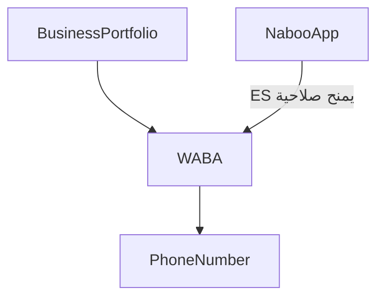
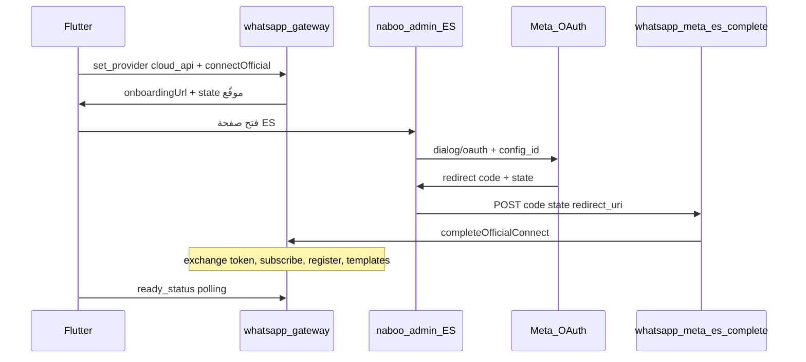

# ربط واتساب Meta مباشرة مع Naboo ERP — رحلة كاملة

**آخر تحديث:** سبتمبر 2026  
**الحالة:** مكتمل 100% — حزمة المنتج جاهزة للإنتاج بعد موافقة Meta  
**المتبقي التشغيلي:** رفع الفيديوهين + Submit في App Dashboard (يدوي)  
**أُغلق:** Webhook signature ✅ • WABA UX guidance ✅ • App Review package ✅  

> **عقد الإغلاق:** الموانع الهندسية الثلاثة مكتملة.  
> ما يبقى: تنفيذ يدوي في Meta (فيديو + Submit + Live بعد الموافقة).  
> لاحق: analytics، أحداث webhook التفصيلية، قوالب تسويق، CRM.

الوثائق الأقدم تبقى مرجعاً تاريخياً (انظر القسم 10). هذه الوثيقة ملخص موحّد لما أُنجز وما يمنع الإنتاج.

---

## 1) الخلاصة التنفيذية

### الهدف

كل محل يربط **رقم واتساب خاص به** داخل نابو لإرسال رسائل تشغيلية (Utility) للعملاء بعد الخدمة:

- تأكيد الخدمة
- بطاقة الغيار المستخدمة
- تذكير الصيانة

### دورنا

- **Tech Provider** لدى Meta
- **WhatsApp Cloud API** + **Embedded Signup v4**
- كل محل ينشئ **WABA** خاص به (حساب واتساب للأعمال)
- لا نشارك credit line — صاحب المحل يضيف وسيلة الدفع على WABA

### البنية التقنية

| طبقة | التقنية |
|------|---------|
| فرونت | Flutter (Naboo) + صفحة ES ثابتة على Vercel |
| باك | Supabase Edge: `whatsapp-gateway` + `whatsapp-meta-es-complete` |
| الاتصال | كل شيء عبر Edge — **لا** Graph API مباشر من Flutter |
| تخزين | `tenant_whatsapp_gateways`, `whatsapp_provider_secrets`, `tenant_whatsapp_templates` |

---

## 2) طبقات Meta (الهرمية)

```
┌──────────────────────────────────────────┐
│  BusinessPortfolio (حافظة المحل)        │
│  مثال: «محل أحمد الأساسي»               │
└────────────────────┬─────────────────────┘
                     │
         ┌───────────┴──────────┐
         │                      │
    ┌────▼─────────┐    ┌──────▼───────┐
    │ WABA #1      │    │ WABA #2      │
    │ (الحالي)     │    │ (قديم)       │
    └────┬─────────┘    └──────────────┘
         │
    ┌────▼──────────────────┐
    │ Phone Number          │
    │ مثال: +964-XXXXXXXXX  │
    └────┬──────────────────┘
         │
    ┌────▼──────────────────┐
    │ Utility Templates      │
    │ - تأكيد الخدمة         │
    │ - بطاقة الغيار         │
    │ - تذكير الصيانة        │
    └───────────────────────┘
```

| العنصر | المعنى | الملك |
|--------|--------|--------|
| BusinessPortfolio | حافظة Meta للمحل — قد تكون فارغة عند الإنشاء | صاحب المحل + Meta |
| WABA | حساب واتساب للأعمال — فيه الرقم والقوالب | صاحب المحل |
| PhoneNumber | الرقم الفعلي (+964…) | صاحب المحل |
| Templates | قوالب الرسائل (نسخة من Registry نابو) | نابو ينشر تلقائياً على WABA المحل |
| تطبيق Naboo app | التطبيق التقني (App ID) | شركة نابو |

**نقاط حرجة:**

- حافظة فارغة ≠ فيها واتساب؛ يجب **إنشاء WABA** أولاً ثم الرقم.
- القالب على **WABA المحل** (ليس عالمياً قابلاً للإرسال من كل المحلات).
- الحافظة الواحدة قد تضم أكثر من WABA؛ لا تختر حافظة/WABA نابو عند ربط محل عميل.



---

## 3) ثلاث طرق الربط في Naboo

من [`lib/verticals/oil_change/models/whatsapp_connect_method.dart`](../../lib/verticals/oil_change/models/whatsapp_connect_method.dart):

| الواجهة العربية | القيمة في DB | المعنى | الحالة |
|-----------------|--------------|--------|--------|
| Meta مباشرة | `cloud_api` | رقم المحل عبر Embedded Signup الرسمي | مسار هذه الوثيقة |
| رقم نابو الرسمي | `dualhook` | مرسِل مشترك `SHARED_SENDER` | موجود / بديل |
| QR | `evolution` | جلسة Evolution غير رسمية | احتياطي أقل استقراراً |

**التركيز هنا:** Meta مباشرة فقط.

---

## 4) تدفق الربط الكامل (End-to-End)



### الخطوات بالتفصيل

1. Flutter: `set_provider('cloud_api')` ثم `connectOfficial()`
2. `whatsapp-gateway`: يوقّع `state` مربوطاً بالمستأجر ويعيد `onboardingUrl`
3. صفحة [`admin-web/public/whatsapp-meta-es.html`](../../admin-web/public/whatsapp-meta-es.html):  
   `dialog/oauth` + `config_id` + `response_type=code` + `redirect_uri` ثابت  
   - `extras: {}` دائماً (v4 الرقم أولاً). **لا زر تعايش**: وثائق ميتا تقول إن التعايش يبدأ تلقائياً عندما يدخل المستخدم رقماً على واتساب الأعمال. جرّبنا featureType وversion v3 وv4-public-preview فبقيت شاشة «إنشاء رقم» نفسها؛ لا تُعد المحاولة.
   - **بدون** `setup.business` و**بدون** `scope` يدوي
4. Meta: تسجيل الدخول / الحافظة / WABA / الرقم / OTP
5. الرجوع لنفس الصفحة بـ `code`
6. `whatsapp-meta-es-complete`: تحقق state → تبادل code → حفظ التوكن → اشتراك webhook على WABA → `register` للرقم → ضمان القوالب → تحديث الحالة
7. Flutter: استطلاع `ready_status` حتى «جاهز»

### الملفات المرجعية

| الملف | الدور |
|-------|--------|
| `supabase/functions/whatsapp-gateway/providers/meta_cloud_transport.ts` | بدء الربط + إكمال المزود |
| `admin-web/public/whatsapp-meta-es.html` | صفحة ES الثابتة |
| `supabase/functions/whatsapp-meta-es-complete/index.ts` | إكمال من الصفحة العامة |
| `supabase/functions/whatsapp-gateway/es_state.ts` | توقيع/تحقق state |
| `supabase/functions/whatsapp-gateway/meta_oauth.ts` | OAuth + Graph (subscribe/register/templates) |
| `lib/verticals/oil_change/screens/oil_change_whatsapp_connect_screen.dart` | شاشة الربط |
| `lib/verticals/oil_change/widgets/whatsapp_official_connect_panel.dart` | لوحة الرقم + أزرار جديد/تعايش |

---

## 5) الأسرار والإعدادات

### على Meta Dashboard

| العنصر | القيمة / المكان |
|--------|------------------|
| App ID (عام) | `1717499336127535` |
| App Secret | سري — خادم فقط |
| ES Config ID (v4) | `952460887300588` |
| Valid OAuth Redirect URI | `https://naboo-admin.vercel.app/whatsapp-meta-es.html` |
| Allowed Domains | `naboo-admin.vercel.app` |

**تنبيه:** Configuration ID ≠ Client Token. يوجد تحت  
**Facebook Login for Business → Configurations**.

### على Supabase Secrets

```bash
META_APP_ID=1717499336127535
META_ES_CONFIG_ID=952460887300588
META_ES_PAGE_URL=https://naboo-admin.vercel.app/whatsapp-meta-es.html
META_APP_SECRET=***   # لا تُلصق في الوثائق
```

### جداول Supabase

| الجدول | الدور |
|--------|--------|
| `tenant_whatsapp_gateways` | مزود، حالة، WABA ID، phone number id، رقم العرض |
| `whatsapp_provider_secrets` | access_token (و PIN التسجيل) لكل مستأجر |
| `tenant_whatsapp_templates` | نسخ القوالب لكل WABA/مزود |

---

## 6) سجل المشاكل التي واجهناها والحل

| # | المشكلة | السبب | الحل | الدرس |
|---|---------|--------|------|--------|
| 1 | صفحة ES تعرض شيفرة HTML | Edge Function لا تستضيف HTML بشكل موثوق | صفحة ثابتة على Vercel | Static على Vercel؛ API على Edge |
| 2 | «سر التطبيق غير موجود» | `META_APP_SECRET` ناقص | تعيين السر في Secrets | الأسرار قبل الاختبار |
| 3 | مشاكل SDK / النطاق | نطاق غير مسموح | تفعيل Login + `naboo-admin.vercel.app` | Domains + Redirect URI |
| 4 | `FB.login` على أندرويد: تبويب ثانٍ ثم «أغلق» بلا code | Popup لا يعيد الكود لنابو | `dialog/oauth` نفس التبويب + redirect | المسار العملي للجوال |
| 5 | زرّان «جديد/تعايش» يفتحان الشاشة نفسها | الشاشة v4 تكتشف نوع الرقم وحدها؛ featureType يُتجاهل | زر واحد + شرح أي رقم يقبله ميتا | لا واجهة اختيار عند ميتا |
| 5b | #2494064 عند إدخال رقم | الرقم على واتساب العادي (الأخضر) أو الإصدار قديم | نقل الرقم إلى واتساب الأعمال ≥ 2.24.17 ثم الربط | الأخضر لا يتعايش أبداً |
| 6 | فشل إرسال بعد «نجاح» ظاهري | نقص `POST /phone_number_id/register` | تسجيل الرقم بعد ES | register إلزامي للمسار القياسي |
| 7 | حافظة فارغة بلا إنشاء WABA | حقن `setup.business` يتخطى شاشات الإنشاء | إزالة حقن business؛ `extras: {}` | لا تحقن إلا عن قصد |
| 8 | `Invalid Scopes: business_management` | scope يدوي مع config_id | الاعتماد على config_id فقط | لا scope يدوي |
| 9 | ربط رقم حافظة نابو/الكابتن | اختبار بحساب مالك التطبيق | حساب محل منفصل؛ لا تختر حافظة نابو | حسابات اختبار مستقلة |
| 10 | الخلط بين Config ID و Client Token | شاشة Advanced Settings | Configurations تحت Login for Business | المكان الصحيح |
| 11 | «الحافظة لا تحتوي حسابات واتساب» | حافظة جديدة بلا WABA؛ ES يعرض مشاركة فقط | نصوص ES + Flutter + زر Business Suite؛ إنشاء WABA ثم إعادة ES | مكتمل UX ✅ |

---

## 7) تجربة صاحب المحل (دليل خطوة بخطوة)

### قبل الربط

- إن كان الرقم على تطبيق واتساب الأعمال الأخضر: استخدم زر **تعايش**.
- حساب فيسبوك/Meta لصاحب المحل (يفضّل غير حساب مالك تطبيق نابو).

### في نابو

1. ربط واتساب → **Meta مباشرة**
2. أدخل **رقم واتساب المحل** (مثال: `07701234567`)
3. اختر **رقم جديد** أو **تعايش**
4. أكمل في نافذة Meta — لا تغلق الصفحة حتى رسالة النجاح

### في Meta

1. تسجيل الدخول
2. أنشئ حافظة باسم **المحل** (اسم فريد؛ ليس Naboo LLC)
3. أنشئ أو اختر **حساب واتساب للأعمال (WABA)** داخل تلك الحافظة  
   - إن ظهرت «لا تحتوي حسابات»: اضغط **عودة** أو أنشئ WABA من [business.facebook.com](https://business.facebook.com) ثم أعد ES
4. أدخل الرقم + أكّد **OTP في Meta** — نابو لا يُدخل الرمز
5. وافق على صلاحيات نابو → العودة التلقائية للتطبيق

### بعد العودة

1. «تحديث حالة التجهيز» حتى **جاهز**
2. اختبار إرسال بطاقة/رسالة تشغيلية من رقم المحل

---

## 8) ما اكتمل مقابل المتبقي

### مكتمل

- تبادل OAuth code على الخادم
- state موقّع (CSRF / ربط مستأجر)
- حفظ توكن لكل مستأجر
- اشتراك التطبيق على WABA
- تسجيل الرقم `register`
- إنشاء/مزامنة القوالب من Registry
- صفحة ES + Flutter UI (رقم + جديد/تعايش)
- توجيه WABA عند حافظة فارغة (نصوص ES + زر Business Suite في Flutter)
- حزمة App Review (نصوص الصلاحيات + سيناريو الفيديو + قائمة Live)
- Config ID v4 `952460887300588` في Secrets
- Redirect URI / Allowed Domains (يجب التحقق قبل كل تجربة)

### متبقي مانع هندسي

لا يوجد.

| # | أُغلق | النوع | الحالة |
|---|--------|--------|--------|
| — | توقيع Webhook `X-Hub-Signature-256` قبل توجيه المستأجر | أمان | مكتمل — `meta_hub_signature.ts` + deploy |
| — | شاشة WABA — UX عند حافظة فارغة | UX | مكتمل — نصوص ES + لوحة Flutter + زر Business Suite |
| — | حزمة App Review + Live | Compliance | مكتمل — [`meta_app_review_submit_ar.md`](./meta_app_review_submit_ar.md) (نصوص + سيناريو فيديو + قائمة Live) |

### متبقي تشغيلي (يدوي في Meta — خارج الكود)

| البند | أين |
|-------|-----|
| تسجيل فيديو messaging + فيديو management | حسب دليل التقديم |
| Submit Advanced Access للصلاحيتين | App Review في لوحة Meta |
| تفعيل Live بعد الموافقة | App Mode = Live |

### لاحق (ليس مانعاً)

| البند | ملاحظة |
|-------|--------|
| توثيق أحداث webhook (تسليم / وارد) تفصيلاً | بعد تثبيت التوقيع |
| Analytics رسائل/تكلفة | منتج لاحق |
| قوالب marketing / OTP إضافية | بعد استقرار Utility |
| تكامل CRM بالمحادثة | لاحق |
| لوحة مراقبة أوسع | لاحق |

---

## 9) قائمة تحقق تشغيلية (قبل كل تجربة محل)

```
[ ] الإعدادات
  [ ] META_APP_SECRET في Secrets
  [ ] META_ES_CONFIG_ID = 952460887300588
  [ ] META_ES_PAGE_URL = https://naboo-admin.vercel.app/whatsapp-meta-es.html
  [ ] Redirect URI مطابق حرفياً في Meta
  [ ] Allowed Domains: naboo-admin.vercel.app

[ ] الاختبار
  [ ] ليس حساب مالك تطبيق نابو
  [ ] حافظة/WABA باسم المحل — لا حافظة نابو ولا «خدمات الكابتن» بالخطأ

[ ] التدفق
  [ ] extras: {} للرقم الجديد
  [ ] featureType تعايش فقط عند اختيار التعايش
  [ ] لا setup.business
  [ ] لا scope يدوي
  [ ] dialog/oauth (ليس FB.login وحده)

[ ] بعد الربط
  [ ] حالة جاهز + قوالب
  [ ] رسالة تجريبية واحدة
  [ ] مراجعة سجلات webhook عند التوفر
```

---

## 10) ملفات المرجع الأقدم (للتاريخ)

- [`whatsapp_self_serve_connect_plan_ar.md`](./whatsapp_self_serve_connect_plan_ar.md) — عقد المنتج والطبقات
- [`whatsapp_official_end_to_end_flow_ar.md`](./whatsapp_official_end_to_end_flow_ar.md) — تدفق الإرسال والجاهزية
- [`meta_app_review_submit_ar.md`](./meta_app_review_submit_ar.md) — حزمة App Review (نصوص + فيديو + Live)
- خطط Dualhook / QR / ops — خارج نطاق Meta مباشرة إلا كبدائل

---

## 11) الخطوات التالية

### الموانع الهندسية — مكتملة كلها

#### مكتمل — توقيع Webhook (أمان)

- الملف: `supabase/functions/whatsapp-cloud-webhook/meta_hub_signature.ts`
- السلوك: تحقق `X-Hub-Signature-256` بـ `META_APP_SECRET`؛ رفض 401 عند فشل التوقيع أو غياب التوقيع لحمولة `whatsapp_business_account` عندما السر مضبوط؛ مسار YCloud كما هو؛ GET `hub.challenge` دون تغيير.

#### مكتمل — شاشة WABA (UX)

- صفحة ES: خطوات قبل البدء + رابط Business Suite + أخطاء OAuth أوضح (`whatsapp-meta-es.html` على Vercel).
- لوحة Flutter: تلميح حافظة→WABA→رقم + زر «فتح Business Suite».
- شاشة WebView: تلميح عند «الحافظة لا تحتوي حسابات واتساب».

#### مكتمل — حزمة App Review + Live (compliance)

- الدليل: [`meta_app_review_submit_ar.md`](./meta_app_review_submit_ar.md)
- نصوص جاهزة: `whatsapp_business_management` + `whatsapp_business_messaging`
- سيناريو فيديوهين + قائمة Live mode
- **التنفيذ اليدوي المتبقي:** تسجيل الفيديو → Submit في Meta → Live بعد الموافقة

### اللاحق (بعد موافقة Meta)

| ترتيب | البند |
|-------|--------|
| 1 | توثيق أحداث webhook (تسليم / وارد) |
| 2 | اختبار إنتاجي أوسع مع محل حقيقي + دفع على WABA |
| 3 | Analytics / فئات قوالب إضافية / CRM |

---

## ملاحظات أمنية نهائية

- `META_APP_SECRET` و access tokens: أسرار خادم فقط — لا في Flutter ولا في الوثائق
- `state`: موقّع ومربوط بمستأجر وبمهلة زمنية
- `redirect_uri`: مطابق حرفياً لما سُجّل في Meta
- Webhook: تحقق `X-Hub-Signature-256` (Meta) قبل المعالجة عندما ينطبق؛ YCloud عند هيدره
- التوكنات: per-tenant في `whatsapp_provider_secrets` — لا توكن مشترك لكل المحلات في مسار Meta مباشرة
