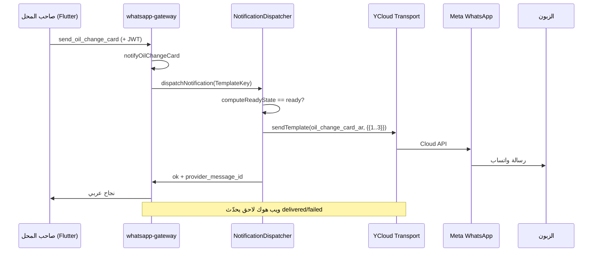

# تقرير متكامل: ربط واتساب وإرسال رسائل غيار الزيت في نابو

**التاريخ:** 2026-07-29  
**النطاق:** من تسجيل صاحب المحل حتى جاهزية الإرسال، مع فصل المسار الرسمي (Meta Cloud عبر YCloud) عن مسار التطبيق/الجسر (واتس360 وغيرها).  
**الجمهور:** منتج، دعم، مطوّر Edge/Flutter.

---

## 1) الخلاصة في جملة

صاحب المحل يرى في نابو فقط: **ربط / جاري التجهيز / جاهز / إرسال**.  
التطبيق **لا يتحدث مع ميتا أو YCloud مباشرة**. كل الربط والإرسال يمر عبر **Edge Function `whatsapp-gateway`**.  
YCloud طبقة نقل فقط؛ القالب منتج مشترك (`oil_change_card_ar`) وليس تصميم لكل محل.

---

## 2) من يفعل ماذا؟ (مسؤوليات واضحة)

| الطرف | ماذا يفعل؟ | ماذا لا يفعل؟ |
|--------|------------|----------------|
| **صاحب المحل (تطبيق Flutter)** | يضغط «ربط واتساب»، يحفظ بطاقة غيار، يرى حالة جاهزية، يشغّل حملة | لا يرى YCloud، لا يرفع قالباً، لا يمرّر مفاتيح API |
| **Edge `whatsapp-gateway`** | يدير الاتصال، القوالب، الجاهزية، الإرسال، السجلات | لا يخزّن `ready_state` كعمود؛ يحسبه عند الطلب |
| **ConnectService** | يبدأ/يكمل/يفصل الربط الرسمي فقط | لا يرسل رسائل، لا ينشئ قوالب محتوى |
| **TemplateLifecycleService** | يضمن وجود قالب المنتج ويزامن حالته من المزود | لا يرسل رسائل |
| **NotificationDispatcher** | يوجّه الإشعار، يعيد المحاولة، يكتب السجل | لا يعرف تفاصيل WABA، لا ينشئ قوالب |
| **OilChangeCardNotifier** | يحوّل بيانات البطاقة إلى طلب إشعار بـ `TemplateKey` | لا يعرف YCloud |
| **YCloud Transport** | استدعاءات API: ربط (إن وُجد)، قالب، إرسال رسالة | ليس واجهة مستخدم؛ ليس منطق أعمال |
| **Meta (واتساب الرسمي)** | يعتمد القوالب، يفرض نافذة 24 ساعة للنص الحر، يسلّم الرسالة للزبون | — |
| **YCloud (كمنصة)** | وسيط تقني أمام Cloud API + ويب هوك الحالة | لا يظهر اسمه للمستخدم النهائي |
| **واتس360 / WAHA / Evolution (جسر)** | إرسال نص جلسة (غير رسمي) عند اختيار هذا المزود | لا يعتمد قوالب ميتا؛ أقل استقراراً |
| **n8n (احتياطي قديم)** | مسار احتياطي إن فشلت البوابة بإعداد ناقص | ليس المسار الأساسي للرسمي |
| **دعم نابو / لوحة YCloud** | ربط WABA ورقم الهاتف يدوياً حالياً (حتى يعمل Embedded Signup) | لا يرسل رسائل الزبائن من التطبيق |

---

## 3) الطبقات المعمارية (من الأعلى للأسفل)

```
┌─────────────────────────────────────────────────────────┐
│  Flutter — شاشة الربط + حفظ البطاقة + الحملة            │
│  (نصوص عربية فقط: غير متصل / جاري التجهيز / جاهز)      │
└──────────────────────────┬──────────────────────────────┘
                           │ JWT + action
                           ▼
┌─────────────────────────────────────────────────────────┐
│  Edge: whatsapp-gateway                                 │
│  ├─ ConnectService                                      │
│  ├─ TemplateLifecycleService + DefaultTemplateRegistry  │
│  ├─ computeReadyState()                                 │
│  └─ notifications/                                      │
│       OilChangeCardNotifier → Dispatcher → WhatsApp ch. │
└──────────────────────────┬──────────────────────────────┘
                           │ WhatsAppProvider interface
                           ▼
┌─────────────────────────────────────────────────────────┐
│  Transport: ycloud | whats360 | waha | evolution | …    │
└──────────────────────────┬──────────────────────────────┘
                           ▼
              Meta Cloud API / جلسة واتساب
```

**قاعدة ذهبية:** دورات حياة منفصلة:

1. **الاتصال** ≠  
2. **القوالب** ≠  
3. **إرسال الإشعار**

---

## 4) الجداول والأسرار (أين تُحفظ الحقيقة؟)

| جدول / سر | المحتوى | من يكتب؟ | من يقرأ؟ |
|-----------|---------|----------|----------|
| `tenant_whatsapp_gateways` | مزود، حالة الاتصال، WABA، phone number id، `ycloud_from_phone` | Edge / دعم | Edge؛ التطبيق يقرأ ملخص الحالة عبر API |
| `tenant_whatsapp_templates` | لكل مستأجر: اسم القالب، اللغة، الحالة (`pending`/`approved`/…) | Edge فقط | Edge؛ التطبيق **لا** يبني UI على هذا مباشرة |
| `whatsapp_provider_secrets` | أسرار مزود لكل مستأجر إن لزم | Edge (service_role) | Edge فقط — **لا RLS للمستخدم** |
| `whatsapp_message_logs` | سجل إرسال: إلى من، قالب، حالة، idempotency | Edge | المستخدم يرى سجلاته عبر RLS select |
| Secrets في Supabase Functions | `YCLOUD_PARTNER_API_KEY` / مفتاح النقل، سر الويب هوك | Ops | Edge + `whatsapp-cloud-webhook` |

**مهم:** الحقل `ready_state` **محسوب** في `computeReadyState()` ولا يُخزَّن كمصدر حقيقة.

---

## 5) مسار صاحب المحل من أول استخدام حتى الإرسال

### المرحلة أ — تسجيل الحساب في نابو

1. يسجّل صاحب المحل / يدخل بحسابه (Supabase Auth).  
2. يصبح عنده `user_id` = هوية المستأجر لواتساب (`tenant_user_id` في جداول القوالب/السجلات).  
3. حتى هذه اللحظة: **لا اتصال واتساب** → الواجهة: **غير متصل**.

### المرحلة ب — فتح شاشة «ربط واتساب» (غيار الزيت)

الملف: `lib/verticals/oil_change/screens/oil_change_whatsapp_connect_screen.dart`

- يستدعي الحالة عبر `OilChangeWhatsappGatewayService` → Edge `status` / `ready_status`.  
- يعرض أحد الحالات العربية:
  - **غير متصل** (`disconnected`)
  - **جاري تجهيز الخدمة…** (`preparing`)
  - **جاهز** (`ready`)

### المرحلة ج — ضغط «الربط الرسمي»

```
التطبيق
  → action: connect_official
  → ConnectService.startOfficialConnect(tenantUserId)
```

ما يحدث داخل الخادم:

1. إن وُجد مسبقاً **WABA + رقم مرسل** مربوطان في `tenant_whatsapp_gateways`:
   - يثبّت الحالة `connected` / `cloud_setup_status=ready`
   - يستدعي `ensureDefaultTemplatesForTenant`
   - يعيد نجاحاً مع رسالة: مربوط، وجاري تجهيز الرسائل حتى اعتماد القالب  
   - **لا يطلب Embedded Signup**

2. إن لم يكن مربوطاً:
   - يضع الصف `connecting` / `pending`
   - يطلب من YCloud Transport `startConnect`
   - **الوضع الحالي:** إن لم يُضبط `YCLOUD_EMBEDDED_SIGNUP_URL`، يفشل بلطف برسالة عربية أن الربط من داخل التطبيق غير مفعّل بعد، والربط يتم من الدعم/YCloud

3. عند اكتمال الربط (ويب هوك أو إجراء `complete_official_connect`):
   - يحفظ: `cloud_waba_id`, `cloud_phone_number_id`, `ycloud_from_phone`, `whatsapp_phone`
   - الحالة: `connected`
   - يشغّل ضمان القوالب الافتراضية

### المرحلة د — تجهيز القالب (بدون تدخل صاحب المحل في تصميمه)

```
TemplateLifecycleService.ensureDefaultTemplatesForTenant
  → يقرأ DefaultTemplateRegistry
  → القالب الوحيد المطلوب اليوم: oil_change_card_ar (TemplateKey.oilChangeCard)
  → يطلب من YCloud إنشاء/جلب القالب على WABA
  → يخزّن الصف في tenant_whatsapp_templates بحالة pending أو approved أو rejected
```

- القالب **منتج نابو مشترك** (نفس النص لكل المحلات؛ المتغيرات فقط تختلف).  
- **ميتا** تراجع القالب (مثلاً تظهر في YCloud: **In review / PENDING**).  
- أثناء المراجعة: الاتصال قد يكون `connected` لكن `ready_state = preparing`.  
- عند الموافقة: مزامنة عبر `sync_templates` أو ويب هوك `whatsapp-cloud-webhook` → `status = approved` → `ready_state = ready`.

### المرحلة هـ — متى يصبح «جاهزاً»؟

منطق `computeReadyState` باختصار:

| المزود | شرط الجاهزية |
|--------|----------------|
| `ycloud` (رسمي) | `status=connected` **و** كل القوالب المطلوبة `approved` |
| `whats360` / `waha` / `evolution` | `status=connected` فقط (لا قوالب ميتا) |
| غير متصل | `disconnected` |

### المرحلة و — إرسال رسالة بعد حفظ بطاقة غيار الزيت

```
حفظ البطاقة في التطبيق
  → OilChangeWhatsappNotifyService.notifyAfterOilChangeSave
```

**إذا المزود `ycloud`:**

1. يبني كتلة التفاصيل `{{3}}` (تاريخ، سيارة، أسعار بالفلس كأرقام عرض، …).  
2. يستدعي Edge `send_oil_change_card`.  
3. الخادم:
   - `notifyOilChangeCard` → `dispatchNotification`
   - يفحص `ready_state == ready` وإلا يرفض بـ `not_ready:preparing`
   - يرسل قالباً عبر YCloud:  
     `{{1}}` اسم الزبون · `{{2}}` اسم المحل · `{{3}}` التفاصيل  
   - يكتب `whatsapp_message_logs` (مع مفتاح idempotency مثل `oil_card:userId:orderId`)
4. YCloud → Meta → هاتف الزبون.  
5. ويب هوك لاحقاً قد يحدّث delivered/failed في السجل.

**إن فشل الرسمي (مثلاً preparing):** التطبيق يسقط إلى مسار النص الحر / الجسر عبر `send_text` ثم n8n عند الحاجة — مع ملاحظة أن **النص الحر على Cloud API غالباً يفشل خارج نافذة 24 ساعة**.

**إذا المزود جسر (واتس360…):** لا يمرّ عبر قالب ميتا؛ `send_text` من البوابة مباشرة كجلسة.

---

## 6) مخطط تسلسلي — الإرسال الرسمي الناجح



---

## 7) مقارنة: الرسمي مقابل «مسار التطبيق» (الجسر)

| البند | الرسمي (ycloud) | الجسر (واتس360 / QR / …) |
|-------|------------------|---------------------------|
| من يظهر للمستخدم | ربط رسمي / تجهيز / جاهز | ربط جلسة / QR / API حسب الشاشة |
| من يرسل فعلياً | Meta عبر YCloud | مزود الجلسة |
| شكل الرسالة | قالب معتمد مسبقاً | نص حر يبنيه التطبيق |
| خارج 24 ساعة | نعم عبر Utility template | غالباً نعم (جلسة) لكن مخالف لسياسات ميتا وأقل استقراراً |
| اعتماد ميتا للقالب | **إلزامي** قبل `ready` | غير مطلوب |
| استقرار الجلسة | أعلى (API رسمي) | انقطاعات شائعة |
| من يضبط الرقم | WABA + رقم في YCloud/دعم | رقم جلسة المزوّد |

---

## 8) إجراءات Edge ذات الصلة

| `action` | المسؤول | الغرض |
|----------|---------|--------|
| `connect_official` | ConnectService | بدء الربط الرسمي |
| `complete_official_connect` | ConnectService | تثبيت WABA/الرقم بعد اكتمال الربط |
| `ready_status` / `status` | ready_state + gateway | ما تعرضه الواجهة |
| `sync_templates` | TemplateLifecycle | مزامنة حالة القالب من YCloud/ميتا |
| `send_oil_change_card` | OilChangeCardNotifier | إرسال البطاقة كقالب |
| `send_text` | index + Transport | نص حر (جسر أو داخل نافذة Cloud) |
| ويب هوك `whatsapp-cloud-webhook` | دورة حياة + سجلات | أحداث الربط/القالب/حالة الرسالة |

---

## 9) ماذا يرى المستخدم مقابل ماذا يحدث خلف الكواليس؟

| ما يراه في نابو | الحقيقة التقنية |
|-----------------|-----------------|
| غير متصل | لا صف متصل، أو `status ≠ connected` |
| جاري تجهيز الخدمة | متصل رسمياً لكن القالب ليس `approved` بعد |
| جاهز | متصل + قالب معتمد (للـ ycloud) |
| تم الإرسال | Dispatcher نجح + غالباً قبول من YCloud/ميتا |
| تعذّر الإرسال | رفض جاهزية، أو خطأ مزود، أو خارج نافذة النص الحر |

صاحب المحل **لا يرى:** اسم YCloud، WABA ID، مفاتيح API، حالة PENDING الخام من ميتا (إلا تلميحاً عبر «جاري التجهيز»).

---

## 10) مسار التشغيل الحالي (واقع الإنتاج حتى تاريخ التقرير)

1. **Embedded Signup داخل التطبيق** غير مكتمل الإعداد بعد → الربط الكامل لرقم المحل يتم غالباً من **الدعم عبر لوحة YCloud**.  
2. حساب تجريبي مربوط قد يستخدم رقم اختبار أمريكي للإرسال حتى يُربط رقم المحل العراقي.  
3. القالب `oil_change_card_ar` يبقى على **In review / PENDING** → `ready_state = preparing` → **لا إرسال قالب رسمي**.  
4. بعد موافقة ميتا: مزامنة الحالة → `approved` → `ready` → الإرسال الحي عبر `send_oil_change_card`.

---

## 11) إجابات سريعة متكررة

**من يرسل الرسالة؟**  
ميتا تسلّمها للزبون؛ نابو يطلب الإرسال عبر Edge؛ YCloud ينفّذ استدعاء Cloud API.

**من يعتمد القالب؟**  
ميتا. نابو ويكلود لا «يوافقان» بديلاً عن ميتا.

**هل التطبيق ينشئ قالباً لكل محل؟**  
لا. قالب منتج واحد؛ صف حالة لكل مستأجر في `tenant_whatsapp_templates`.

**لماذا متصل ولا يرسل؟**  
لأن الجاهزية = اتصال **و** قالب معتمد. الاتصال وحده = `preparing`.

**هل الحملة الجماعية نفس مسار البطاقة؟**  
الحملة غالباً `sendCustomMessage` (نص). البطاقة بعد الحفظ تفضّل القالب الرسمي إن كان المزود `ycloud`.

---

## 12) ملفات المصدر الأساسية

| المسار | الدور |
|--------|------|
| `migrations/20260729_whatsapp_notification_architecture.sql` | الجداول الجديدة |
| `supabase/functions/whatsapp-gateway/lifecycle/connect_service.ts` | الربط |
| `supabase/functions/whatsapp-gateway/lifecycle/template_lifecycle_service.ts` | القوالب |
| `supabase/functions/whatsapp-gateway/lifecycle/ready_state.ts` | الجاهزية المحسوبة |
| `supabase/functions/whatsapp-gateway/lifecycle/default_template_registry.ts` | تعريف `oil_change_card_ar` |
| `supabase/functions/whatsapp-gateway/notifications/**` | Dispatcher + القناة + المُنبّه |
| `supabase/functions/whatsapp-gateway/providers/ycloud_transport.ts` | طبقة النقل |
| `supabase/functions/whatsapp-cloud-webhook/index.ts` | أحداث YCloud |
| `lib/verticals/oil_change/services/oil_change_whatsapp_notify_service.dart` | قرار الإرسال من التطبيق |
| `lib/verticals/oil_change/services/oil_change_whatsapp_gateway_service.dart` | استدعاءات Edge |
| `lib/verticals/oil_change/screens/oil_change_whatsapp_connect_screen.dart` | واجهة الربط |

---

## 13) جملة ختامية للتشغيل

> المستخدم يسجّل في نابو → يربط واتساب (رسمياً عبر دعم/YCloud اليوم، لاحقاً Embedded Signup) → النظام يضمن القالب المشترك → ميتا تعتمد القالب → الحالة تصبح «جاهز» → عند حفظ بطاقة غيار الزيت يطلب التطبيق من البوابة إرسال القالب → Dispatcher يتحقق من الجاهزية → YCloud يرسل عبر ميتا → الزبون يستلم الرسالة، والسجل يُحدَّث عبر الويب هوك.
